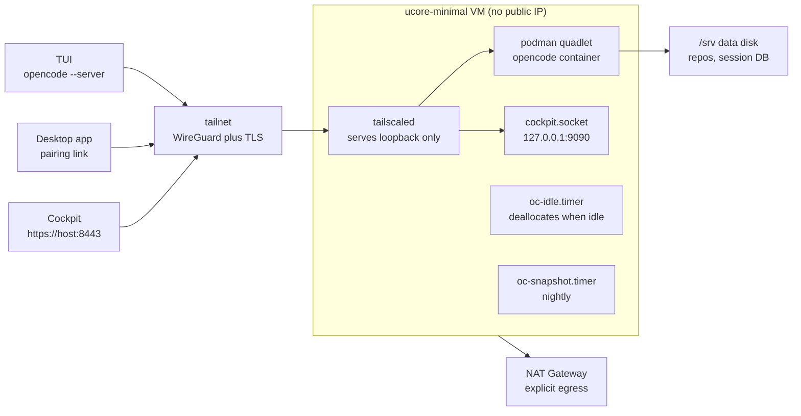

# devbox-oc

An AI development server in Azure that you can destroy and rebuild without
losing work. The operating system is ucore-minimal, a Fedora CoreOS derived image
built from its upstream bootc container, so a VM boots it directly. The toolchain
runs in a Fedora container. The OpenCode TUI and desktop app connect to it
directly over a private tailnet, with no public IP and no open inbound port.

## Why it exists

Local dev environments drift and break in ways that cost hours and produce
nothing. Here the environment is two images plus a data disk, so recovery is a
redeploy rather than a repair.

## Architecture



## Three update cadences, deliberately independent

| Layer | Built by | Updated by |
|---|---|---|
| OS image (`ucore-minimal`) | `pipelines/devbox-os.yml`, building a VHD from the upstream bootc container pinned by digest | `rpm-ostreed-automatic.timer`, staged, applies on next boot |
| Container image | `pipelines/devbox-image.yml` into ACR | `podman auto-update` on the `:prod` tag, gated by the idle check |
| Data disk | not built | nightly incremental snapshot |
| Tailnet path | `tailscaled` enabled by Ignition, then `oc-tailnet.service` | both must be up; without them the box is Bastion-only |

Fusing the first two would make every OpenCode release an OS rebuild plus a
reboot. They stay separate on purpose.

## The idle contract

The box deallocates itself after 45 idle minutes so it does not bill while you
are not working. It stays up while any of these is true:

- a session is running
- a shell command is running
- a terminal is open
- a turn is blocked on an approval
- a turn is blocked on a form question

**What is not protected.** A connected TUI with no running turn does not keep the
box up. Neither does an SSH session, nor a build running outside an OpenCode
turn. Tailscale connection state and container process liveness are too noisy to
gate on: an idle editor holding a socket would pin the box awake forever and
defeat the cost goal. Hold the box open deliberately with the pin file when you
need to:

```sh
sudo touch /var/lib/oc-idle/pin
```

A probe error means **stay up** while the container is running, because a half-started
container may still hold a session. With the container down, an unreadable API is
treated as idle instead, so a box that refuses to serve does not also refuse to stop.

## Cost shape

Approximate, westeurope, USD, at the time of writing:

| Item | Monthly |
|---|---|
| `Standard_B2as_v2` (2 vCPU / 8 GiB) running 24/7 | 63 |
| the same, on a weekday schedule with idle stop | ~12 |
| OS disk, 64 GiB Premium SSD | 11 |
| Data disk, 128 GiB Standard SSD | 10 |
| NAT Gateway | 33 |
| Snapshots | ~6 |
| ACR Basic | 5 |
| Bastion Developer (break-glass) | 0 |

The disks and the NAT Gateway are fixed costs that sleeping does not remove, so
they dominate once the VM is on a schedule.

## Run the tests

Everything the repo asserts runs through one gate:

```sh
./tests/verify.sh
```

It runs every suite and then `shellcheck` over all shell scripts. It ends with
`VERIFY: all suites pass`.

Individual suites:

| Suite | What it protects |
|---|---|
| `host/tests/test_oc-idle-check.sh` | the box is never stopped while busy; probes fail closed |
| `host/tests/test_oc-secrets.sh` | the server password file is mode 0600 and never clobbered by an empty secret |
| `host/tests/test_tailnet_up.sh` | the tailnet join is idempotent and uses a durable node |
| `host/tests/test_cockpit_loopback.sh` | Cockpit listens on loopback only and is published over the tailnet |
| `host/tests/test_quadlet_persistence.sh` | persistent data is on the data disk, never a named volume on the OS disk |
| `os/tests/test_build_os_image.sh` | the OS image script refuses without its tools and emits a valid image ID |
| `os/butane/tests/test_units_have_scripts.sh` | every unit runs a script that is baked into the image |
| `image/tests/test_integrity_logic.sh` | the OpenCode artifact's sha512 is verified, with a negative control |
| `image/tests/test_digest_record.sh` | the rollback digest record holds exactly one valid digest |
| `terraform/tests/no_public_ip.sh` | no public IP and no internet-allow ingress |
| `terraform/tests/no_scheduled_stop.sh` | no scheduled hard stop ever returns |
| `terraform/tests/data_disk_protected.sh` | the data disk stays `prevent_destroy` |

Two suites are proven able to fail, not just able to pass: the integrity test
rejects a corrupted tarball, and the idle gate rejects a forced-allow pin check.

## What is not verified here

This repo has no Azure subscription and no container engine. So:

- `terraform validate` passes, but no `plan` or `apply` has run.
- The container image has never been built. `image/smoke.sh` runs in the pipeline
  as a blocking gate before promotion.
- The OS image has never been built. The bootc build path, the `vhd` output type,
  and a Gen2 boot are unverified against a real subscription.
- Pipeline definitions parse as YAML, but no pipeline run has executed.

Anything requiring credentials is unproven until the first real run.

## Documentation

- `docs/runbook.md` covers restore, rollback, tailnet rejoin, snapshot pruning.
- `docs/pipelines.md` covers building this repo from Azure DevOps into the work
  subscription.
- `docs/superpowers/specs/` holds the design and its verified facts.
- `docs/superpowers/plans/` holds the implementation plan.

## Status

All twelve tasks of the plan are implemented, with every invariant guarded by a
test proven able to fail. See `CHANGELOG.md` for the change list and for the
honestly unverified gaps.
