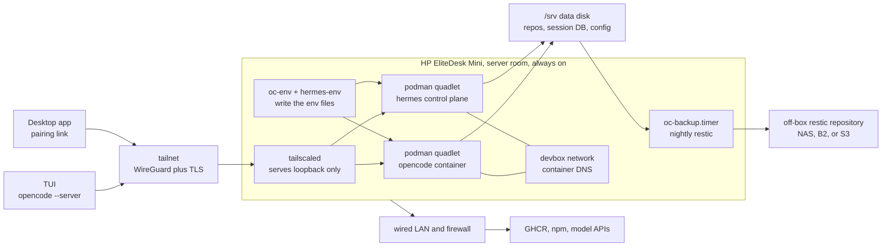

# devbox-oc

An AI development server on an HP EliteDesk G4 35W Desktop Mini in a server
room. It runs ucore-minimal, a Fedora CoreOS derived image, as an immutable host,
runs the OpenCode server and the Hermes control plane in podman containers on a
shared internal network, and is reached only over a private tailnet. The OS disk
and the data disk are separate, and a nightly restic backup leaves the box.

## Why it exists

Local dev environments drift and break in ways that cost hours and produce
nothing. Here the environment is two images plus a data disk, so recovery is a
rebuild rather than a repair.

The box used to be an Azure VM. Terraform, Key Vault, ACR, the idle
deallocator, and the wake wrapper are gone with it: the Mini has no control
plane to pay for and no reason to scale to zero. `docs/design.md` records the
pivot and its reasons.

## Architecture



## Three update cadences, deliberately independent

| Layer | Built by | Updated by |
|---|---|---|
| OS (`ucore-minimal`) | upstream, installed from Fedora CoreOS media then rebased once | `rpm-ostreed-automatic.timer`, staged, applies on next boot |
| Container image | `.github/workflows/image.yml` into GHCR | `podman auto-update` on the `:prod` tag, kept only if the health check passes |
| Data (`/srv`) | not built | nightly restic backup to an off-box repository |

Fusing the first two would make every OpenCode release an OS rebuild plus a
reboot. They stay separate on purpose.

The container update is not gated on idleness. `podman-auto-update.timer` fires
on its own schedule and restarts the container when `:prod` moves. The health
check decides whether a new image is kept, not whether a session is running.

## Secrets

| Secret | Where it lives | Written by |
|---|---|---|
| `OPENCODE_PASSWORD` | `/etc/devbox/secrets.env`, mode 0600 | operator, after first boot |
| `API_SERVER_KEY` | `/etc/devbox/secrets.env` | operator, after first boot |
| One model provider key (`OPENROUTER_API_KEY`, `ANTHROPIC_API_KEY`, `OPENAI_API_KEY`, or `GOOGLE_API_KEY`) | `/etc/devbox/secrets.env` | operator, after first boot |
| Optional Hermes keys (`HERMES_DASHBOARD_BASIC_AUTH_*`, `TELEGRAM_BOT_TOKEN`, `DISCORD_BOT_TOKEN`, `TZ`) | `/etc/devbox/secrets.env` | operator, optional |
| `RESTIC_REPOSITORY`, `RESTIC_PASSWORD` | `/etc/devbox/secrets.env` | operator, after first boot |
| Tailscale auth key | `/etc/devbox/tailscale-authkey`, mode 0600, in Ignition | `os/butane/build.sh`; empty in a keyless build |
| SSH public key | Ignition, no secret | `os/butane/build.sh` |

`oc-env.service` reads the password from `secrets.env` and writes
`/etc/opencode/env`. `hermes-env.service` reads the same file and writes
`/etc/hermes/env`, filtered to an allowlist. Each fails closed on a missing key,
and each quadlet carries `Requires=` on its writer, so a failed write never
serves an unauthenticated server.

In a keyed build, the Tailscale key is the only secret on the install media. It
is scoped to a tag, single-use or short-lived, and revoked after the node
appears. Revoking it does not disconnect the node: identity lives in
`/var/lib/tailscale`. A keyless build ships no key, and you join from the console
after first boot.

## Always on

There is no idle deallocation and no scheduled stop. Suspend and hibernate are
masked in Ignition, and logind sets `IdleAction=ignore`. A UPS covers a short
power cut; the firmware setting to power on after AC loss covers the rest.

## Run the tests

Everything the repo asserts runs through one gate:

```sh
./tests/verify.sh
```

It runs every suite and then `shellcheck` over all shell scripts. It ends with
`VERIFY: all suites pass`.

Set `BUTANE` when you change anything under `os/butane/`, or the artifact
reproducibility check skips:

```sh
BUTANE=/path/to/butane ./tests/verify.sh
```

| Suite | What it protects |
|---|---|
| `host/tests/test_oc-env.sh` | the environment file is 0600 and an empty password fails closed |
| `host/tests/test_hermes-env.sh` | the Hermes env file is 0600, allowlisted, and fails closed |
| `host/tests/test_hermes_quadlet.sh` | the Hermes quadlet persists on `/srv`, stays on loopback, and the backup orders both workloads |
| `host/tests/test_oc_backup.sh` | the backup runs the Fedora image, mounts data read-only, and never prunes |
| `host/tests/test_tailnet_up.sh` | the tailnet join is idempotent, durable, and needs a real key |
| `host/tests/test_cockpit_loopback.sh` | a shipped Cockpit socket is bound to loopback and is not published |
| `host/tests/test_no_lan_listener.sh` | sshd is masked and no unit declares a non-loopback listener |
| `host/tests/test_nosleep.sh` | sleep targets are masked and `IdleAction=ignore` is set |
| `host/tests/test_quadlet_persistence.sh` | persistent data is on the data disk and the workload fails closed |
| `host/tests/test_quadlet_health.sh` | the quadlet health command is the API probe the image installs, not a version print |
| `os/butane/tests/test_autorebase.sh` | one enabled rebase unit, pinned, marked, disabled, rebooted |
| `os/butane/tests/test_no_azure.sh` | no Azure endpoint or deleted module survives |
| `os/butane/tests/test_tailscale_enabled.sh` | `tailscaled` is enabled and orders the join |
| `os/butane/tests/test_keyless_build.sh` | a keyless build ships no key and keeps the console autologin |
| `os/butane/tests/test_units_have_scripts.sh` | every unit runs a shipped script, and the artifact reproduces |
| `os/butane/tests/test_data_mount.sh` | the data disk is mounted by a canonical path, not the `/srv` symlink |
| `image/tests/test_integrity_logic.sh` | the OpenCode artifact's sha512 is verified, with a negative control |
| `image/tests/test_digest_record.sh` | the rollback digest record holds exactly one valid digest |
| `image/tests/test_healthcheck.sh` | the health command accepts a serving API and rejects anything else |
| `image/tests/test_smoke_requires_pin.sh` | the smoke gate refuses to run without a version pin |
| `image/tests/test_prod_digest.sh` | a stale digest record fails and the repair keeps the header |
| `image/tests/test_promote_digest.sh` | a stale record fails, is repaired, and opens exactly one repair PR |
| `tests/docs_suite_table.sh` | every suite the gate runs is listed in the README table, and no row outlives its suite |
| `tests/ci_shape.sh` | CI publishes to GHCR behind a smoke gate |
| `tests/docs_complete.sh` | the install and recovery topics stay written down |
| `vm/tests/test_overlay_merge.sh` | the VM overlay appends to the shipped Ignition, is idempotent, and never rewrites the base |
| `vm/tests/test_run_args.sh` | the VM boots the harness Ignition with two disks, no inbound port forward, and a disk plan it would write or reuse |
| `vm/tests/test_disk_write.sh` | the disk write path creates both disks, renames them into place, cleans up a failed create, and reuses them without `--rebuild` |
| `vm/tests/test_guest_helpers.sh` | every helper the guest check calls is defined, so an assertion cannot vanish |
| `vm/tests/test_guest_assertions.sh` | the guest boot and mount parsers read the shapes the VM produces |
| `vm/tests/test_guest_data.sh` | the data-disk repart refuses the running root device |
| `vm/tests/test_report_agent.sh` | a truncated guest report is refused and cannot read as a pass |
| `vm/tests/test_report_verdict.sh` | the host verdict rejects a truncated, empty or summary-less report |

Every guard was checked against a mutation it is meant to catch, and the mutation
was confirmed to land before the result was trusted. The integrity test has a
documented negative control: it rejects a corrupted tarball.

## Rehearse the install in a VM

Before the Mini is touched, the whole install path runs on a workstation under
QEMU:

```sh
./vm/run-vm.sh --rebuild
```

It boots the pinned Fedora CoreOS image, applies the Ignition compiled from
`os/butane/ucore.bu`, rebases to ucore on first boot, then runs a check suite
inside the guest and exits non-zero on any failure. A passing run ends with
`VM DOGFOOD: pass`. The guest posts its report to a host agent bound to
`127.0.0.1`; there is no inbound port forward. First boot takes 10 to 20 minutes,
mostly the rebase download.

This is step 0 of `docs/install.md`, and the rehearsal for every host change.
Nothing in `os/butane/`, `host/`, `image/` or a quadlet should reach the Mini
without a passing run. Ignition is first-boot only, so use `--rebuild` after a
change. `--console` attaches the serial console, and `--stop` powers the VM down.
The full procedure, the checks, and the limits are in `docs/vm.md`.

## What is not verified here

No install has run on the target Mini. No live boot has been tested on the
Mini's hardware. The container image has been built by the GitHub Actions
workflow and pulled by the VM, but not exercised on the target. The restic
restore drill has not been executed, the keyless console join has not run, and
the ucore rebase has run only under QEMU, not on the Mini. The VM harness covers
the config and the container start path, and its full run passes on this
workstation; the firmware, disk ids, tailnet join, UPS, and thermals still need
the real box. Nothing here should be described as working until it runs against
real hardware.

## Documentation

- `docs/design.md` records the architecture, the pivot, and the hardware risks.
- `docs/install.md` is the first-install procedure.
- `docs/runbook.md` covers daily checks, backup, restore, rollback, and disk
  replacement.
- `docs/web-access.md` covers the tailnet-only client path: the served address,
  browser sign-in, CORS, verification, teardown, and the failures.
- `docs/vm.md` covers the QEMU rehearsal that precedes the install: the pinned
  base image, the overlay, the checks, and what a passing run still cannot claim.
- `CHANGELOG.md` records every landed change and the honest gaps.

## Status

The bare-metal pivot is implemented on `refactor/bare-metal-pivot` until it
merges. The invariants named above each have a guard, and those guards were
checked against mutations they are meant to catch. See `CHANGELOG.md` for the
change list.
