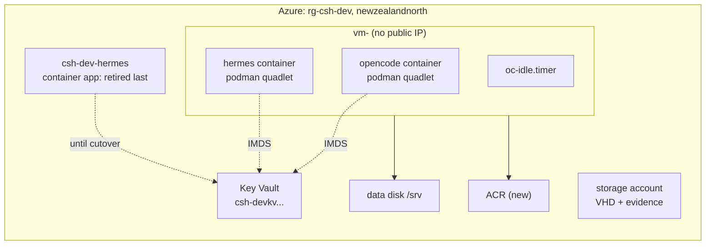

# Deployment plan: first real run

Status: draft, for working through together.
Baseline: `main` at b13eb1a. Nothing in this repo has ever run against a real
Azure subscription.

Target: `rg-csh-dev` in `newzealandnorth`, subscription
`b44e1a7e-e9e1-4c4d-a9d0-028fb4515f51` (Pay-As-You-Go). That resource group
already exists and is in use, which changes this plan from a greenfield build to
an adoption.

---

## What already exists

Read from the subscription with `az resource list -g rg-csh-dev`, which returns
eight entries: seven top-level resources plus one child. The seven are what the
portal shows in the screenshot, and the child is the environment's certificate.

| Resource | Name | Type | Disposition |
|---|---|---|---|
| Container Apps Environment | `csh-dev-env` | `Microsoft.App/managedEnvironments` | Adopt. Consumption profile, no VNet integration. |
| Environment certificate | `csh-dev-env/cf-origin-ultus` | `managedEnvironments/certificates` | Child of the environment. Cloudflare Origin CA. |
| Container app | `csh-dev-hermes` | `Microsoft.App/containerApps` | Migrates to a quadlet on the new VM. |
| Identity | `csh-dev-hermes-identity` | User-assigned identity | Has Key Vault Secrets User on the vault. |
| Identity | `csh-dev-plane-identity` | User-assigned identity | Belongs to the plane, not to Hermes. |
| Key Vault | `csh-devkvb6lmephspqf2u` | Key Vault | Adopt. Holds 11 secrets. |
| Log Analytics | `csh-dev-logs` | Workspace | Reuse. |
| Storage account | `cshdevfilesb6lmephspqf2u` | Storage account | Reuse for the OS VHD. |
| ACR | none in this group | Container registry | **Must be created.** |

The resource group itself is the container for those eight, not an entry in the
list. There is no ACR anywhere in the subscription matching `csh`, so Phase 1
creates one.

Storage shares, read separately with `az storage share-rm list`: `hermes-data`
(Hermes state, migrates to the data disk), `plane-state` and `augur-workspace`
(not this project's, leave).

### The environment constrains the network plan

`csh-dev-env` is a Consumption-only environment with `vnetConfiguration: null`,
so it owns no subnet and does not collide with the VNet Terraform creates. Its
static IP is `172.204.116.151`, and its default domain is
`salmonhill-b7ee3ceb.newzealandnorth.azurecontainerapps.io`, which is the domain
in Hermes's dead `WORKFLOW_PLANE_URL`. That confirms the URL pointed at an app in
*this* environment, and the app was deleted while the environment stayed.

Three consequences for adoption:

- Terraform must not manage `csh-dev-env`. It is absent from the configuration
  and does not need to be there. Leave it unmanaged and it bills only its
  Consumption usage.
- The VNet Terraform creates (`vnet-${name_prefix}`, `terraform/main.tf:8`) is
  independent of the environment, because the environment is not VNet-injected.
  No address-space negotiation is needed.
- The environment outlives this migration. Retiring `csh-dev-hermes` does not
  remove it, so decide separately whether it should be deleted once the last app
  is gone.

Subscription and vault confirmed with `az group show` and `az keyvault show`.

## Corrections to earlier claims in this session

**The resource inventory was wrong twice.** I first listed seven resources and
omitted `csh-dev-env`, its Cloudflare certificate, and `csh-dev-plane-identity`.
Correcting that, I then wrote "ten entries" and then "nine", both by counting the
output in my head instead of asking for the length. Measured with
`az resource list -g rg-csh-dev --query "length(@)"` the answer is 8: seven
top-level resources plus one child. The table above is that list, and the only
row beyond those eight is the ACR that Phase 1 creates.

**Hermes is not broken.** I said it was, because `WORKFLOW_PLANE_URL` points at
`csh-dev-plane.salmonhill-b7ee3ceb.newzealandnorth.azurecontainerapps.io` and that
container app no longer exists. The gateway process answers Discord without the
plane, and you confirmed the bot works. `az containerapp show` reports
`runningStatus: Running` and `provisioningState: Succeeded`. The dead URL is a
latent dependency, not an outage: anything routed through the plane is
unavailable until a plane exists again.

That distinction matters for sequencing. Hermes is a working system, so the
migration is a cutover with rollback, not a rebuild.

---

## Shape after this plan



Two quadlets on one VM, one identity, one vault. Hermes keeps its Discord
surface and gains the data disk. The container app is retired only after the
quadlet has served for a decided period.

## The constraint that shapes everything: idle

`oc-idle-check` deallocates the VM after 45 idle minutes. Its five busy signals
are all OpenCode API endpoints (`host/bin/oc-idle-check:93-121`), and its
container check asks only about `opencode.service`
(`host/bin/oc-idle-check:123-125`).

Hermes is a Discord gateway. It holds a websocket and does work when a message
arrives, including at 3am. The idle gate cannot see any of that. So the moment
Hermes moves onto this VM, the box will deallocate under a live bot and the bot
will stop answering.

Three ways out, and this is decision 1:

| Option | Effect | Cost |
|---|---|---|
| A. Pin the box awake | Hermes always available; idle gate defeated | ~63 USD/month, loses the main cost lever |
| B. Add a sixth signal | Gate watches the Hermes process or its last-activity stamp | Code change in `oc-idle-check`, new suite |
| C. Keep Hermes on the container app | Bot stays always-on, VM stays cheap | Hermes does not move; contradicts the goal |

I recommend **B**, with the pin as the interim. A Discord gateway shows liveness
in its own logs, so a stamp file refreshed on activity is the same pattern the
OpenCode signals already use. It is a real code change and needs its own PR.

Do not pick A by default. It silently converts a cost-optimised design into a
fixed-cost one.

---

## Phase 0: what you hold

| Item | Why | Check |
|---|---|---|
| `rg-csh-dev` ownership | adoption | `az group show -n rg-csh-dev` |
| Role-grant rights at RG scope | Terraform declares 5 role assignments unconditionally plus a 6th with the schedule (`terraform/main.tf:213,241,248,254,288`, `terraform/schedule.tf:21`) | you can grant User Access Administrator |
| Tailscale tailnet + reusable auth key | only data path | admin console |
| Hermes Discord app credentials | already in the vault | `DISCORD-BOT-TOKEN` present |
| `hermes-data` share contents | migration source | you have read access to the share |

`hermes-data` is an Azure Files share. Reading it needs
`Storage File Data SMB Share Reader` or an account key. My current identity has
neither, which is why the migration needs you for that step.

## Phase 1: adopt the resource group, create only what is missing

1. **Make the vault name an input.** Terraform derives
   `kv-${name_prefix}-${sha256(subscription)[:n]}` (`terraform/main.tf:272`).
   With `name_prefix = "csh-dev"` that computes to `kv-csh-dev-b9bed3f8`, which
   is not `csh-devkvb6lmephspqf2u`. The existing vault cannot be reached by the
   derivation, so `local.key_vault_name` becomes a variable with the existing
   name as its value.

   This is a code change with three dependants:
   `terraform/tests/key_vault_name_derived.sh`,
   `terraform/tests/authkey_name_matches_build.sh`, and
   `terraform/tests/password_secret_name_matches.sh`. It ships as its own PR.

2. **Import the resource group** before the first plan:
   `terraform import azurerm_resource_group.this /subscriptions/b44e1a7e-.../resourceGroups/rg-csh-dev`.
   Without this the plan tries to create a group that exists.

3. **Create the ACR.** `az acr create -n <name> -g rg-csh-dev --sku Basic`,
   with `acr_resource_group = "rg-csh-dev"` and `acr_name` set. Choose the role
   mode deliberately: `acr_abac_enabled` decides whether the pull identity needs
   `Container Registry Repository Reader` or `AcrPull` (`terraform/main.tf:275-284`).

4. **Decide the vault's purge protection.** The existing vault has
   `purgeProtection: null` while `terraform/main.tf:138` sets
   `purge_protection_enabled = true`. Importing will show this as a change that
   Azure cannot apply in the other direction: purge protection cannot be turned
   off once on. Set the Terraform value to match reality, or accept that the
   plan reports a permanent diff.

5. **Service connection** named `devbox-image`, with Contributor, Container
   Registry Repository Writer, and User Access Administrator at RG scope.

**Check:** `terraform plan` shows no create for the resource group or the vault,
and no destroy of anything.

**Stop if** the plan wants to replace the vault. That is the 11 secrets.

## Phase 2: publish the OS image

Unchanged from the merged runbook, with the adopted names.

1. Set `resourceGroup: rg-csh-dev` and `storageAccount: cshdevfilesb6lmephspqf2u`
   in `pipelines/devbox-os.yml`. Leave the builder digest pinned.
2. Run the pipeline. Record the image ID, the VHD sha256, and
   `az image show -n <name> -g rg-csh-dev --query hyperVGeneration`.

**Check:** image ID matches `^/subscriptions/.+/providers/Microsoft.Compute/images/.+$`
and `hyperVGeneration` is `V2`.

**Stop if** the builder fails. Likely causes, in order: podman storage not shared
with the builder, bootc ref not in local storage, missing declared root
filesystem (handled by `--bootc-default-fs ext4`, `os/build-os-image.sh:77,80`).

## Phase 3: build and promote the container image

Do this before the first boot. The VM is created running, and its quadlet points
at `:prod` (`host/quadlet/opencode.container:17`), which does not exist until
this phase.

1. Run `pipelines/devbox-image.yml` against the new ACR.
2. Confirm `:prod` exists and `image/prod-digest.txt` holds one 64-hex digest.

**Check:** `az acr repository show-tags -n <acr> --repository devbox` lists the
sha tag and `prod`.

## Phase 4: generate Ignition with the adopted names

1. `terraform -chdir=terraform init`, then decide the state backend.
2. Export the runbook values. `VAULT_NAME` is now
   `csh-devkvb6lmephspqf2u` directly, not a console derivation.
3. `./os/butane/build.sh`.

**Check:** `grep -c placeholder os/butane/ucore.ign` returns 0. The plan-time
precondition at `terraform/main.tf:183` asserts the same.

## Phase 5: apply

1. `terraform -chdir=terraform plan -out=tfplan`.
2. Read the plan for: no public IP, the data disk protected, `os_image_id` equal
   to the Phase 2 ID, and no replacement of the vault or the resource group.
3. Apply.

**Check:** the box deallocates itself after 45 idle minutes. That is the idle gate
and the cost model both working.

## Phase 6: verify the boot

```
ssh core@devbox "sudo rpm-ostree status"
ssh core@devbox "systemctl is-active tailscaled oc-secrets oc-tailnet opencode"
ssh core@devbox "systemctl is-enabled tailscaled"
ssh core@devbox "sudo podman ps --format '{{.Names}} {{.Status}}'"
```

**Check:** the booted deployment names `ucore-minimal`, all four units active,
`tailscaled` enabled, the container healthy.

**Stop if** `rpm-ostree status` names `fedora-coreos`. Wrong image, and every host
unit assumes ucore packages.

## Phase 7: connect, and confirm one door

1. `opencode pair --url https://devbox.<tailnet>.ts.net`, and the TUI.
2. Cockpit at `https://devbox.<tailnet>.ts.net:8443`.

**Check:** the TUI runs a command, Cockpit loads over the tailnet,
`nc -z 127.0.0.1 9090` succeeds on the host, and there is no public IP.

## Phase 8: migrate Hermes onto the VM

This is the phase that was not in the previous plan. It is a migration, because
Hermes currently works.

**Order matters: add before remove.** The container app stays up and serving
Discord until the quadlet has run long enough to trust.

1. **Decide idle handling first.** Option B from the constraint table: add a
   signal to `oc-idle-check` so Hermes activity keeps the box up. Its own PR,
   with a suite that proves the gate no longer deallocates under activity.
   Interim: pin the box awake, and accept the cost for the migration window.

2. **Move the state.** Copy `hermes-data` from the Azure Files share to
   `/srv/hermes` on the data disk. The container mounts `/opt/data` today
   (`properties.template.containers[0].volumeMounts`), so the quadlet keeps that
   mount path and only the backing store changes.

3. **Write the quadlet.** Same image, pinned by the digest currently deployed
   (`nousresearch/hermes-agent@sha256:55e192fb...`), same args (`gateway run`),
   same four env vars. The two secrets come from Key Vault by the existing
   `oc-secrets` pattern, not from the quadlet. Reuse `csh-dev-hermes-identity`
   or give the VM identity its own grant; do not create a third identity.

4. **Run it beside OpenCode.** Both quadlets, one VM, `podman-restart.service`
   already enabled. Confirm `podman ps` shows both healthy.

5. **Cut over Discord.** Stop the container app, watch the bot answer from the
   VM. Keep the app's definition (do not delete) for the rollback window.

6. **Retire after a decided period.** Delete `csh-dev-hermes` only after the
   quadlet has served through at least one real workload and one VM restart.

**Check:** a Discord message gets an answer with the container app stopped, and
the answer survives a VM restart with the box woken by `oc`.

**Stop if** the bot answers while the container app is still running after the
cutover. That means two gateways are live on one token, which Discord permits but
which will duplicate replies.

## Phase 9: prove recovery, then close the gaps

1. **Rebuild proof.** Apply again, confirm the data disk reattaches and `/srv`
   survives, including `/srv/hermes`.
2. **Idle proof.** Leave idle past the threshold, confirm deallocation and that
   `oc` wakes it. With Hermes on the box, this now proves the idle signal too.
3. **Snapshot proof.** Run `oc-snapshot`, then the restore drill at
   `docs/runbook.md:232-285` against a throwaway disk.

Then file, as work items: the plan's two sequencing defects if not resolved here,
the non-idle-gated `podman auto-update`, the CI-skipped integrity suite, and
whatever `terraform plan` reveals that `validate` cannot.

---

## Decisions

1. **Idle with Hermes on the box.** Option A pin, Option B new signal, or Option C
   keep Hermes on the container app? I recommend B with A as the interim. This is
   the decision that most changes the cost and the code.

2. **Vault name.** Confirm it becomes an input variable holding
   `csh-devkvb6lmephspqf2u`, shipped as its own PR with the three suites updated.
   The alternative, renaming the vault to match the derivation, means migrating
   11 secrets and is not worth it.

3. **Purge protection.** Match Terraform to the vault's current `null`, or turn it
   on and accept that it is permanent? Turning it on is the safer default for a
   vault holding production credentials.

4. **Hermes identity.** Reuse `csh-dev-hermes-identity` for the quadlet, or grant
   the VM's system-assigned identity `Key Vault Secrets User` and retire the
   user-assigned one? Reusing is fewer moving parts. Retiring it is cleaner if the
   container app is truly going away.

5. **Rollback window.** How long does the container app stay defined after
   cutover before deletion? I would say one week of real use plus one restart.

## What this plan does not cover

- The dead `WORKFLOW_PLANE_URL`. Anything Hermes routes through the plane stays
  unavailable until a plane exists. Out of scope here, and worth its own item.
- `plane-state` and `augur-workspace` shares. Not this project's resources.
- Multi-box deployments. The vault name collides within one subscription by
  design (`terraform/main.tf:119-128`), and after this change it is an explicit
  input, so a second box needs a second vault name by hand.
- Rotating the vault secrets after the VM is live.
