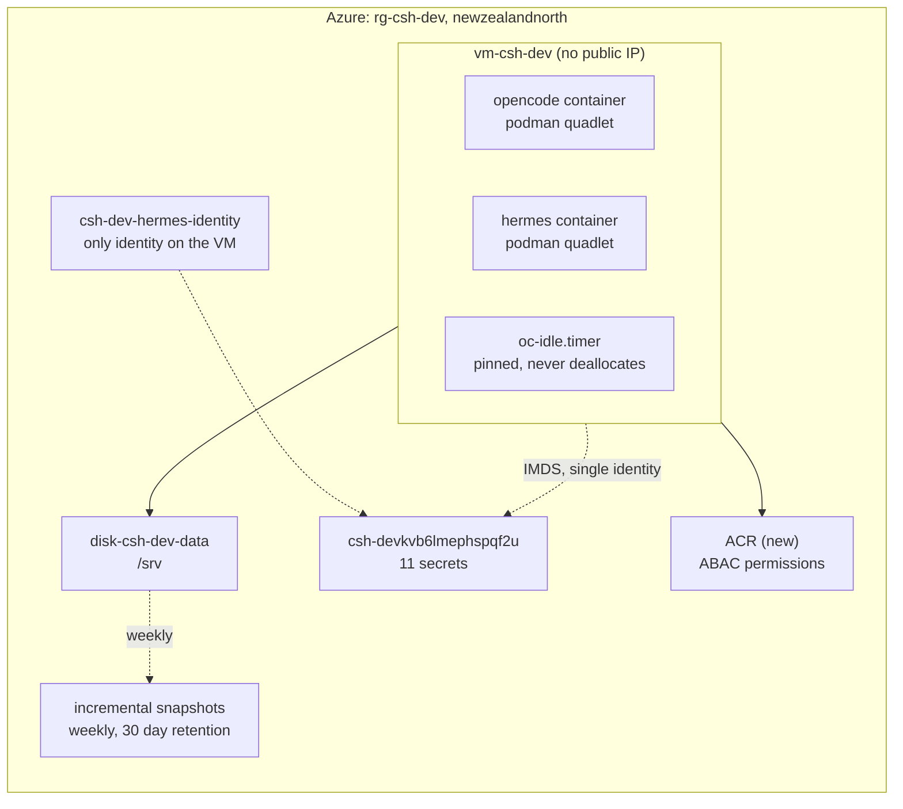
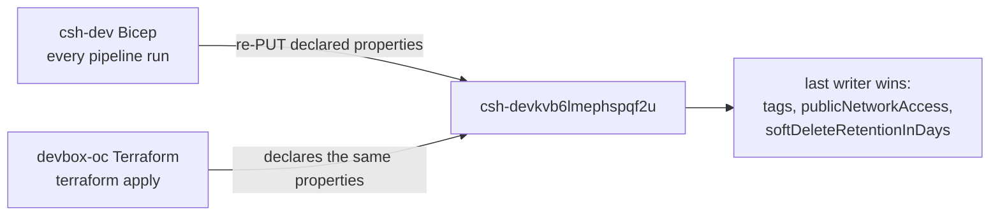

# Deployment plan: replace the ACA deployment with a Bicep-owned devbox VM

Status: draft decisions settled, pending review. Baseline: `main` at `b13eb1a`.
Nothing in this repo has ever run against a real Azure subscription.

Target: `rg-csh-dev` in `newzealandnorth`, subscription
`b44e1a7e-e9e1-4c4d-a9d0-028fb4515f51` (Pay-As-You-Go).

The shape has changed from "adopt the resource group into Terraform" to
"replace the Container Apps deployment with a VM, inside the Bicep that already
owns the resource group". The resource group, the vault and the identities stay.
The deployment mechanism changes hands.

---

## Who owns `rg-csh-dev` today

Read from Azure DevOps, not assumed. The owner is Bicep, in organization
`Jacobsens`, project `AzureAppDev`, repo `csh-dev`, and it is deployed by pipeline.

| Fact | Evidence |
|---|---|
| Target scope is the existing resource group | `infra/main.bicep`: `targetScope = 'resourceGroup'` |
| Deployed by pipeline | `pipelines/azure-pipelines.yml`: `az deployment group create --resource-group rg-csh-dev --template-file infra/main.bicep` |
| Last change | 2026-10-21, PR 1183, `fix(hermes): seed the Discord gate and the model provider key into the profile .env` |
| The decision it encodes | `docs/decisions/0001-aca-over-vm.md`, status accepted, 2026-10-09 |

What that template declares, all of it in `rg-csh-dev` unless noted:

| Module | Declares |
|---|---|
| `modules/environment.bicep` | `csh-dev-logs`, `csh-dev-env` |
| `modules/storage.bicep` | `cshdevfilesb6lmephspqf2u` and its three shares. **The account was deleted 2026-11-03, so this module must go** |
| `modules/keyvault.bicep` | `csh-devkvb6lmephspqf2u`, plus the role assignments |
| `modules/identity.bicep` | `csh-dev-plane-identity`, `csh-dev-hermes-identity` (when Hermes is on) |
| `modules/plane.bicep` | `csh-dev-plane` |
| `modules/hermes.bicep` | `csh-dev-hermes` |
| `modules/budget.bicep` | `csh-dev-monthly`, 200 NZD hard, alerts at 60 and 100 percent |

A pipeline run on this template today would recreate the storage account the
operator just deleted. That is the first hazard to remove, before any VM work.

## Two corrections to earlier versions of this plan

**The vault name is derivable, and an earlier version said it was not.** That
version claimed the vault `csh-devkvb6lmephspqf2u` could not be reached by
derivation and had to become an input variable. That was true only of this repo's
Terraform formula, `sha256(var.subscription_id)` at `terraform/main.tf:272`. The
real derivation is Bicep's `uniqueString(resourceGroup().id)` in
`infra/modules/keyvault.bicep`. It produces 13 characters, so `csh-dev` + `kv` +
`b6lmephspqf2u` is 22 characters, exactly the live name. The same suffix produces
`cshdevfilesb6lmephspqf2u` at 24 characters. No input variable is needed, and the
whole "three suites depend on it" branch of the previous plan is dead.

**No import step exists.** An earlier version required
`terraform import azurerm_resource_group.this`. In Bicep the resource group is the
deployment target, so there is no resource to import and no state to drift.

## Decisions taken

| # | Decision | Taken |
|---|---|---|
| 1 | Availability of Hermes | Pin the VM awake, 24/7 |
| 2 | Vault name | Moot. Bicep already derives the live name |
| 3 | Purge protection | Turn it on, permanently |
| 4 | Identity on the VM | Attach `csh-dev-hermes-identity` as the only identity |
| 5 | Rollback window | Moot. The operator deleted the app 2026-11-03, so Phase 6 is a fresh stand-up |
| 6 | ACR role mode | `AbacRepositoryPermissions`, matching the Terraform default |
| 7 | IaC ownership | Port the VM into `csh-dev` Bicep, retire the whole ACA surface |
| 8 | ADR | Supersede `0001-aca-over-vm.md` with a new ADR in `csh-dev` |
| 9 | Plan scope | This document, rewritten now |
| 10 | Egress | No NAT gateway, no static IP. `defaultOutboundAccess: true` |
| 11 | Storage | No storage account. Data disk plus snapshots only |
| 12 | Backup model | Git and Azure DevOps are the backup. Snapshots are an undo |
| 13 | Snapshots | Weekly, 30 day retention |
| 14 | Budget | Stay at 200. The new shape prices at 183 to 196 |
| 15 | VM size | **`B2as_v2`, 2 vCPU / 8 GiB** as the starting SKU. Container jobs are phase 2, so local subagents stay on the box |
| 16 | Container jobs | Deferred. Phase 2, after the VM is proven |

Decisions 1 and 12 are the two that change the code. Pinning makes the idle gate a
no-op, and treating git as the backup is what makes weekly snapshots enough rather
than nightly ones.

Decision 14 is the binding constraint on this plan. The previous version proposed
raising the budget to cover the pinned cost, which would have hidden a 246 NZD
design behind a bigger number. The budget does not move.

## Shape after this plan



There is no storage account in this shape. It was deleted on 2026-11-03, taking
the three shares and the `workflow-evidence` blobs with it. That removes the
migration source and the image staging path, so the plan no longer has either.

Kept: the resource group, the vault, `csh-dev-hermes-identity`, `csh-dev-logs`, and
the budget. Already gone, deleted by the operator on 2026-11-03:
`csh-dev-env`, `csh-dev-hermes`, `csh-dev-plane`, `csh-dev-plane-identity` and
`cshdevfilesb6lmephspqf2u`. Nothing in this plan deletes a live resource.

## What already exists

Read with `az resource list -g rg-csh-dev` on 2026-11-04. Three entries remain,
down from six, because `csh-dev-env` and `csh-dev-hermes` were deleted on
2026-11-03 at 03:17Z (activity log, `Microsoft.App/managedEnvironments/delete`,
Succeeded). An app has no life outside its environment, so deleting the
environment removed both.

| Resource | Name | Type | After this plan |
|---|---|---|---|
| Log Analytics | `csh-dev-logs` | Workspace | **Keep.** The jobs log sink |
| Key Vault | `csh-devkvb6lmephspqf2u` | Key Vault | **Keep.** 11 secrets |
| Identity | `csh-dev-hermes-identity` | User-assigned identity | **Keep.** Becomes the VM identity |

Deleted before this plan started: `csh-dev-env` and `csh-dev-hermes` with the
environment certificate under it, `csh-dev-plane` and `csh-dev-plane-identity`,
and the storage account with the three shares and the blob container. There is no
ACR anywhere in the subscription matching `csh`, so the template creates one.

`modules/environment.bicep` still declares `csh-dev-env` and `csh-dev-logs`. That is
drift to clean up, not something to keep. Phase 7 deletes the module and gives
`csh-dev-logs` its own declarer, because the environment cannot be recreated (the
subscription is over the five-environment limit) and leaving the module in place
makes every deployment fail validation.

**The Hermes state is already lost.** `hermes-data` was the only copy, so there is
nothing to carry into Phase 6. The process that might have read it is also gone, so
treat the first boot as a fresh start and let Discord reconnect the gateway.

## Why replace rather than add

The VM must live in the same resource group as the vault and the identity. Two
tools writing that group is a real hazard, and the vault is where it lands.



Bicep declares `publicNetworkAccess: 'Enabled'`, `softDeleteRetentionInDays: 7`
and no `tags` on the vault. The Terraform at `terraform/main.tf:119-142` declares
all three. Whichever runs last resets the other, and neither plan expresses the
other's intent. The vault is the remaining shared object now that the storage
account is gone, and it is the one that matters.

One writer per resource group is the rule that removes this class of bug. Since
Bicep already holds the group and the vault, the VM goes into Bicep.

## The constraint that decides the cost model: idle

`oc-idle-check` deallocates the VM after 45 idle minutes. Its five busy signals
are all OpenCode API endpoints (`host/bin/oc-idle-check:93-121`), and its
container check asks only about `opencode.service`
(`host/bin/oc-idle-check:123-125`).

Hermes is a Discord gateway. It holds a websocket and answers at any hour. None
of those five signals can see it. Move Hermes onto the box unchanged and the box
deallocates under a live bot.

Decision 1 was pin the box awake, so this plan pins it and pays for it. The
mechanism half exists: `host/bin/oc-idle-check:47-50` exits early when
`/var/lib/oc-idle/pin` exists, and `/var/lib` persists across reboots. What is
missing is the file itself.

**This is new work, not an existing behaviour.** `os/butane/ucore.bu` declares no
`/var/lib/oc-idle/pin` entry: grep for `pin` over that file matches only the
`dropins:` keys at `os/butane/ucore.bu:222` and `:233`. `docs/runbook.md:376-377`
shows the operator creating and removing the file by hand, which is what the
mechanism was built for. An earlier version of this plan claimed Ignition creates
it at first boot, and that was wrong.

**Required edit, same PR as the Butane change:** add the file to
`os/butane/ucore.bu` as a `storage.files` entry with `path:
/var/lib/oc-idle/pin`, `mode: 0644` and empty contents. Then recompile
`os/butane/ucore.ign` with `os/butane/build-placeholder.sh`, because that artifact
must stay byte-identical and a hand edit fails the gate. Set `BUTANE` when running
`./tests/verify.sh`, or the reproducibility check prints `SKIP` and still exits 0.

Two honest notes about pinning:

- **The scheduled start becomes pointless.** With the box never deallocating,
  the Logic App in `terraform/schedule.tf:8` and its role assignment at
  `terraform/schedule.tf:21` wake a machine that is always awake. They are not
  ported.
- **The idle gate becomes dead code that still runs** every five minutes. Keeping
  it is deliberate: if Hermes ever leaves the box, removing one file restores
  cost control. Deleting it is a follow-up item, not part of this change.

## What the actuals say, and what the new shape costs

October, `rg-csh-dev`, ActualCost grouped by resource and meter, in NZD. These
are the numbers that fired the budget, and they are history: the storage account
and the plane are already gone, so the Files line is zero from 2026-11-03.

| Line | NZD | Still billed after this change |
|---|---|---|
| Azure Files `Standard Transactions` | 242.33 | No, account deleted |
| Azure Files `LRS Write Operations` | 63.09 | No, account deleted |
| `csh-dev-hermes` compute, all meters | 97.66 | No, replaced by the VM |
| `csh-dev-plane` compute, all meters | 39.67 | No, already deleted |
| Azure Files reads, protocol, stored | 12.91 | No, account deleted |
| `csh-devkvb6lmephspqf2u` | 0.03 | Yes |
| **Total** | **455.64** | |

Two things about that table are worth stating, because a reader cannot check them
from the document:

- **The rows are rounded, so they do not sum to the total.** They add to 455.69
  against a stated 455.64, and the 0.05 is rounding across the grouped rows, not a
  missing line. The total is the authoritative figure and the rows are indicative.
- **It is a reproduced query, not a remembered number.** Re-run it with:
  - Scope: `/subscriptions/b44e1a7e-e9e1-4c4d-a9d0-028fb4515f51/resourceGroups/rg-csh-dev`
  - `POST .../providers/Microsoft.CostManagement/query?api-version=2023-11-01`
  - `type: ActualCost`, `timeframe: Custom`, `2026-10-01T00:00:00Z` to
    `2026-11-01T00:00:00Z`
  - `granularity: None`, aggregation `Sum` on `Cost`, grouped by dimension
    `ResourceId` and dimension `Meter`
  - `az rest --method post` with that body, then sum the returned rows

  `az costmanagement` does not exist in the CLI as installed here, which is why the
  command uses `az rest`. The API rate-limits repeated queries with a 429, so
  re-running it needs a pause between attempts.

### What November confirms, measured three days after the delete

The same query with the window ending `2026-11-06T00:00:00Z` and
`granularity: Daily` shows the deletion in billing rather than in the activity log.
Grouped by resource, in NZD:

| Day | Storage account | `csh-dev-hermes` |
|---|---|---|
| 2026-11-01 | 15.21 | 0 |
| 2026-11-02 | 15.35 | 4.81 |
| 2026-11-03 | 1.84 | 0.63 |
| 2026-11-04 | 0 | 0 |
| 2026-11-05 | 0 | 0 |

Three things follow, and each is measured, not projected:

- **Storage was the whole bill, and it was transaction-driven.** 15.21 and 15.35
  NZD per day to serve one bot polling an SMB share. At that rate the storage
  account alone passes the 200 NZD budget in 13 days, before any compute.
- **The line stops at the delete.** 1.84 on 2026-11-03 is the partial day, then
  zero. This is the check that the "zero from 2026-11-03" claim above needed.
- **Month-to-date total is 37.83 NZD.** 32.40 is the storage account, 5.44 is the
  container app, and the Key Vault and Log Analytics rows stay at 0.00. The 0.01
  against the summed total is rounding across grouped rows.

The new shape, priced at retail for `newzealandnorth` from the Azure Retail
Prices API, 730 hours per month, 1 USD = 1.7773 NZD (frankfurter.app, 2026-11-02).
ACR bills per day, so it uses 730/24 = 30.42 days, not 30:

| Line | SKU | USD | NZD/month |
|---|---|---|---|
| Compute | `Standard_B2as_v2`, 2 vCPU / 8 GiB | 0.0998/hr | 129.48 |
| Data disk | `E10`, 128 GiB StandardSSD_LRS | 13.7088/mo | 24.36 |
| Data disk transactions | `E10 LRS Disk Operations`, unbudgeted below | 0.002/10K | 0 to 4 |
| OS disk | `P6`, 64 GiB Premium_LRS | 10.207/mo | 18.14 |
| ACR | Basic registry | 0.1666/day | 9.01 |
| Key Vault | 11 secrets, standard | | 0.03 |
| Egress | default outbound access | 0 | 0 |
| NAT gateway | **not deployed** | | 0 |
| Static IP | **not deployed** | | 0 |
| **Subtotal** | | | **181.02 to 185.02** |
| Snapshots, weekly, 30 day retention | 4.5 runs, 2 to 10 GB changed | | 2.1 to 10.6 |
| **Total** | | | **183 to 196** |

181.02 is the sum of the rounded rows above with transactions at zero. Computed
from unrounded values it is 181.03, and the 0.01 is rounding, not a missing line.

**Standard SSD bills transactions, and an earlier version of this table did not.**
`E10 LRS Disk Operations` is 0.002 USD per 10K, so 0.36 NZD per million
operations. Capacity-only pricing is wrong for this disk type. A dev box doing git
checkouts, image pulls and builds plausibly runs 1 to 10 million operations a
month, which is 0.36 to 3.6 NZD. The table says 0 to 4 because that is the honest
range before measurement, and the low bound of the total is therefore optimistic.

This is the same pricing class as the line that fired the budget, which is why it
is called out rather than folded into the disk row. The 242.33 NZD was not stored
bytes either. If the first month's actuals show this line above 5 NZD, the answer
is to measure IOPS per workload, not to move to Standard HDD: that trades 0.0005
per 10K for latency on a box whose whole job is interactive builds.

Against the 200 NZD budget, that is under it, with 4 to 17 NZD of headroom. The
low end is the one to plan against: 200 minus 196, which is the total with disk
transactions at the top of their range. The compute is 129 of the 181, so the only
large lever left is the SKU.

### The VM size, verified

The sizes below come from two independent sources that agree: the retail API
`armSkuName` with its `MemoryGB` capability, and Microsoft's Basv2 size table.

| SKU | vCPU | Memory | Base CPU | Credits banked/hr | Max banked | USD/hr | NZD/month |
|---|---|---|---|---|---|---|---|
| `B2ats_v2` | 2 | 1 GiB | 20% | 24 | 576 | 0.0125 | 16.22 |
| `B2als_v2` | 2 | 4 GiB | 30% | 36 | 864 | 0.0499 | 64.74 |
| `B2as_v2` | 2 | 8 GiB | 40% | 48 | 1,152 | 0.0998 | 129.48 |
| `B4als_v2` | 4 | 8 GiB | 30% | 72 | 1,728 | 0.177 | 229.64 |

`B2as_v2` at 2 vCPU / 8 GiB is confirmed. So is the claim that `B2als_v2` is
2 vCPU / 4 GiB and `B2ats_v2` is 2 vCPU / 1 GiB.

**The "untested" hedge was wrong, and there is a measurement.** As a
representative figure, this workstation holds 16 OpenCode processes totalling
5.33 GiB RSS, an average of 341 MiB each. A server container plus one Hermes
gateway is two processes, not sixteen, so 4 GiB is not obviously too small. It is
still a guess for the host, the kernel and the container together, which is why
the schedule below exists rather than a recommendation.

What 8 GiB buys over 4:

| | `B2als_v2` | `B2as_v2` |
|---|---|---|
| Memory | 4 GiB | 8 GiB |
| Base CPU | 30% of 2 vCPU | 40% of 2 vCPU |
| Credits banked/hr | 36 | 48 |
| Sustained CPU before throttling | 0.6 vCPU | 0.8 vCPU |
| Cost | 64.74 NZD/month | 129.48 NZD/month, **64.74 more** |

Both are burstable, so the sustained figure is the one that matters for a long
compile. The larger SKU also carries a higher baseline, which is a second reason
not to read the choice as memory-only.

**How to settle it without guessing.** Deploy `B2as_v2` first, and treat
`B2als_v2` as the resize to try once the box is idle and measured. A resize is a
deallocate and a SKU change on the same disk, so the decision is reversible either
way. Measure after the first week of real work:

```
ssh core@devbox "free -m"
ssh core@devbox "sudo podman stats --no-stream"
ssh core@devbox "cat /sys/fs/cgroup/cpu.stat"
```

Downsize to `B2als_v2` when all three hold: no swap in use at steady state, peak
`podman stats` under about 3 GiB including the host, and `cpu.stat` showing
`nr_throttled` flat during a build. Anything else means the 64.74 NZD/month for
the larger SKU is buying real headroom.

### Why 8 GiB, not 4

Container jobs are phase 2, so until they exist the box runs the subagents. That
is the whole argument: OpenCode spawns subagents as local processes, and each one
carries its own memory. At the measured 341 MiB average per process, an 8 GiB box
holds the server, Hermes, and roughly a dozen concurrent subagent processes before
it starts swapping. A 4 GiB box holds two or three.

This workstation is the evidence for how quickly that adds up: 16 processes,
5.33 GiB, from ordinary session use. Three subagents plus the server plus Hermes
is five processes, which fits in 4 GiB, but a fan-out is how an agent turns into
five more, and swapping during a build is the failure this repo must not ship.

So `B2as_v2` is the starting point and `B2als_v2` is the resize target. Starting
large and shrinking on evidence is a decision that cannot break work. Starting
small and growing on evidence is one that can.

### Container jobs are phase 2

The operator's plan is an OpenCode plugin that runs subagents as Azure Container
Apps jobs instead of local processes. Deferred, so it is not a reason to under-size
the box today.

Rates for `newzealandnorth`, per second, recorded now so phase 2 starts from
measured numbers:

| Meter | USD/second | Per hour |
|---|---|---|
| `Standard vCPU Active Usage` | 0.000036 | 0.1296 per vCPU |
| `Standard Memory Active Usage` | 0.000005 | 0.018 per GiB |
| `Standard vCPU Idle Usage` | 0.000005 | near zero when idle |

A subagent at 1 vCPU and 2 GiB for ten minutes is about 0.0276 USD, or 0.05 NZD.

Two things phase 2 has to solve, neither in scope here: a job has no local disk,
so it cannot read `/srv/repos` as it stands, and it needs its own identity to reach
Key Vault. Both are impedance points on the order of the six above.

When phase 2 lands, `B2als_v2` becomes the better default, because the memory
pressure moves off the box. That is a phase 2 resizing decision, not a phase 1 one.

Three conclusions, each measured:

- **The transaction line was never stored bytes.** `LRS Data Stored` was 0.07 NZD.
  The 242.33 NZD was SMB operation volume at 0.0370 NZD per 10K, dominated by
  `Create`, `Close` and `QueryInfo` at about 136,700 an hour around the clock.
  The volume and the rate are a rounded pair: 65,439,848 operations at exactly
  0.0370 gives 242.13, and 242.33 over 0.0370 gives 65,494,595. The charge is real
  and the two figures disagree by 55,000 operations, which is rate rounding across
  a month rather than a missing line.
- **That traffic was Hermes, not the plane.** An earlier version could not attribute
  it. The deletion settled it: `csh-dev-plane` is gone from the resource group, and
  the rate did not move, 135,682 in the 18:00 hour on 2026-11-02 against 136,672 on
  2026-10-20 when both apps ran. With the plane gone, `hermes-data` was the only
  mounted share. 136,700 an hour is 38 operations a second, and the shape is 12
  file Creates, 12 Closes and about 14 `QueryInfo` calls a second, with almost no
  Writes. That is a polling loop, not storage.
- **The VM is not the saving.** The compute is 129.48, against 137.33 for both
  container apps. The saving is 318 NZD of Files transactions that disappear
  because a VM has a disk next to it, and a container app does not.

### The NAT gateway, deleted

64.87 NZD/month, removed. The argument and the platform rule are in impedance
point 6. The earlier version treated a choice this repo made as a platform
requirement, which is how 64.87 NZD/month of avoidable cost entered the design.

### Snapshots are an undo, not a backup

Git and Azure DevOps are the backup. `docs/runbook.md:227-230` already says this
and the wording was right: the data disk is not a backup, and anything you would
grieve over must be pushed to a remote.

What the data disk holds beyond a remote is uncommitted work: `/srv/repos` before
a push, and `/srv/opencode/state`, which is the session database and is expensive
to rebuild rather than irreplaceable. Snapshots exist for those, and for the case
where a bad change corrupts the disk mid-session.

That lowers what they are worth. The rate is 0.132 USD/GB-month for changed
blocks, weekly is enough for an uncommitted-work undo, and the retention carries
the cost:

| Schedule | Runs held in 30 days | Changed per run | NZD/month |
|---|---|---|---|
| Weekly, 30 day retention | 4.5 | 2 GB | 2.1 |
| Weekly, 30 day retention | 4.5 | 10 GB | 10.6 |
| Nightly, 30 day retention | 30 | 2 GB | 14.1 |
| Nightly, no retention (today) | grows without limit | 2 GB | 14.1 and rising |

Weekly plus 30 days is the operator decision, and it is the right one under a
git-backup model: 2.1 to 10.6 NZD/month instead of a line that only grows, and
the loss it accepts is up to seven days of uncommitted work rather than one. If
that is too much to lose, the fix is a push, not a denser snapshot schedule.

The run count is rounded up, deliberately. A 30 day window over a 7 day period is
30/7 = 4.29 runs, and 4.29 at 2 GB is 2.01 NZD. The table prices 4.5, which gives
2.11, because the fifth run is partially retained and a cost estimate that rounds
up is the one that cannot surprise. The 0.132 USD/GB-month rate applies to changed
blocks, so the cost tracks changed bytes per run and not disk size.

`host/bin/oc-snapshot` creates only. The retention rule is new work: delete
snapshots oldest first until only those inside the 30 day window remain, and never
delete the newest one, whatever the date arithmetic says.

That reverses a documented decision, so every file carrying the old rule changes in
the same PR that adds the timer. Today `docs/runbook.md:286-294` says "Retention is
deliberately manual. Removing backups from a timer is a destructive action that
deserves a human decision, so no automation does it." Leaving that in place while
shipping a timer gives the repo two contradicting answers to the same question, and
the runbook is the one an operator reads during a restore.

The reversal is justified because the premise changed. Retention was manual while
snapshots were the backup, so deleting one destroyed the only copy. Under a
git-backup model they are an undo for uncommitted work, and an undo that grows
without limit is a bill with no matching risk reduction.

**Required edits, all in the PR that lands the timer.** An earlier version of this
section named two files and missed four, which would have shipped a repo that
disagrees with itself. The full set:

| File | What is wrong today | Edit |
|---|---|---|
| `docs/runbook.md:227-230` | "Nightly incremental snapshots give a 24 hour recovery point" | weekly, 7 day recovery point |
| `docs/runbook.md:286-294` | "Retention is deliberately manual ... no automation does it" | `oc-snapshot.timer` prunes to a 30 day window. Keep the listing command. Keep "never remove the newest snapshot before a verified restore" for anything older than the window |
| `README.md:28` | diagram node reads `oc-snapshot.timer<br/>nightly` | `weekly`, and `30 day retention` |
| `README.md:42` | "nightly incremental snapshot" | weekly, 30 day retention |
| `os/butane/ucore.bu:175-181` | `Description=Nightly data disk snapshot` and `OnCalendar=*-*-* 02:00:00 UTC` | weekly calendar, renamed description. Recompile `ucore.ign` afterwards |
| `host/bin/oc-snapshot:5-6` | comment says "Creates only. Retention is a documented manual step" | comment describes the prune the script now performs |

The ordering matters: change the script and the timer first, then the docs, in one
commit, so there is no window where a document describes a prune that does not run
or a timer that runs unpruned. Do not land the retention work as a docs-only
change.

## The impedance points, worked out

This is where a naive port fails. Each was checked against the file it concerns.

### 1. The identity is gated on Hermes being deployed

`infra/main.bicep` creates the Hermes identity inside
`module hermesIdentity ... = if (deployHermes)`. Retiring the container app sets
`deployHermes=false`, and the identity the VM now depends on would be deleted
with it. The section that removes the app must not remove the identity.

**Fix:** move the identity out of the `deployHermes` condition and give it its
own module call with no gate, before the VM module consumes `identityId`. The
resource name `csh-dev-hermes-identity` must not change, because that name is in
the live role assignment.

### 2. The `hermes-data` share is also gated on `deployHermes`

Moot, and worth recording as such. `infra/modules/storage.bicep` declared
`hermesShare ... if (deployHermes)`, and the point was that incremental mode would
leave it in place so the container app could keep writing during the rollback
window. The share and the whole storage account were deleted on 2026-11-03, so
there is nothing to preserve and no rollback data.

**Fix:** delete `modules/storage.bicep` and its shares from the template entirely.
Incremental mode will not recreate a resource that is no longer declared, but it
will recreate the account if the module stays.

### 3. Ignition cannot be rendered inside the template

`os/butane/build.sh:9` requires `VAULT_NAME`, `ACR_NAME`, `DISK_ID`, `RG`,
`SUBSCRIPTION_ID` and `SSH_PUBKEY`, and substitutes them into `ucore.ign`. The
vault name comes from `uniqueString()`, which is an ARM function with no faithful
offline equivalent, so the build script cannot reproduce it.

**Fix:** two-stage deployment in one pipeline run.

1. Stage one deploys network, disk and ACR, and outputs the disk resource id.
2. The pipeline builds `ucore.ign` from those outputs.
3. Stage two deploys the VM with `customData` as a parameter.

`loadFileAsBase64` has a 96 KB limit, and the current `os/butane/ucore.ign` is
18,569 bytes, about 24.2 KB base64, so it fits. Use a generated parameters file
rather than an inline argument, because the base64 will not survive shell
quoting at that size.

**Stop if** the Ignition grows past roughly 70 KB, because base64 plus JSON
escaping starts crowding the limit.

### 4. The OS image id is produced by this repo's pipeline

`os/build-os-image.sh:108` prints the image id and
`pipelines/devbox-os.yml:15-17` still names `rg-devbox-oc`,
`stdevboxocimages` and `westeurope`. The image is built by `devbox-oc`, so the
Bicep cannot compute the id. It becomes a required parameter with no default, so
a deploy without it fails instead of booting a stale image.

Keep `os/build-os-image.sh:77,80` and the `--bootc-default-fs ext4` argument.
Keep the `sha256sum` provenance line at `:96`.

### 5. ACR role mode uses ARM enum names, not CLI names

`az acr create --role-assignment-mode` takes `rbac` or `rbac-abac`. The Bicep
property `roleAssignmentMode` takes `AbacRepositoryPermissions` or
`LegacyRegistryPermissions`. Using the CLI spelling in Bicep validates and then
fails at deploy.

**Fix:** set `AbacRepositoryPermissions` explicitly, and grant the VM identity
`Container Registry Repository Reader` (`b93aa761-3e63-49ed-ac28-beffa264f7ac`).
Do not grant `AcrPull` (`7f951dda-4ed3-4680-a7ca-43fe172d538d`), which ABAC mode
ignores.

### 6. Egress: no NAT gateway, no static IP

The Terraform subnet sets `default_outbound_access_enabled = false`
(`terraform/main.tf:23`), so it needed an explicit egress method and chose a NAT
gateway plus a static public IP (`terraform/main.tf:68-77`).

That flag is a choice this repo made. Microsoft documents the alternative plainly:
"You can still configure subnets as nonprivate using any supported method (ARM
templates, portal, CLI, PowerShell)." Set `defaultOutboundAccess: true` and the
subnet provides egress with no gateway and no address.

| | NAT gateway + static IP | `defaultOutboundAccess: true` |
|---|---|---|
| Hourly charge | 0.045 gateway + 0.005 static IP = 0.050 USD | 0 |
| Monthly, NZD | 64.87 | 0 |
| Public IP on the NIC | none | none |
| Inbound path | none | none |
| Egress address stable | yes | no, Microsoft-owned |
| Tailscale | works | works |

Nothing in this design needs a stable egress address. Tailscale dials out from the
host, accepts no inbound connection, and resolves peers by name on the tailnet. The
fixed address buys nothing, so it is not ported.

The NAT gateway rate is a `Global` retail row (`Standard Gateway`, 0.045 USD/hour).
There is no `newzealandnorth` row for it, so treat the gateway rate as indicative.
The static IP rate is regional and measured (`Standard IPv4 Static Public IP`,
0.005 USD/hour). 0.050 USD/hour over 730 hours is 64.87 NZD/month, which is the
figure this plan removes. `Basic` static IP is cheaper at 0.0036 and cannot be
used here: NAT gateway requires a Standard SKU address.

64.87 covers only the gateway hours. NAT gateway also bills data processed at
0.045 USD/GB, so any real traffic adds to it and the deleted design was worse than
the number this plan claims to save.

**Set the property explicitly.** Omitting `defaultOutboundAccess` is not the same
as `true`: subnets created against an API version after 2026-03-31 default to
`false`, and the symptom is a VM that boots with no egress at all. The NSG still
denies inbound from the Internet, and no public IP is attached, so
`terraform/tests/no_public_ip.sh` keeps passing.

## Phase 0: what you hold

| Item | Why | Check |
|---|---|---|
| Rights on `csh-dev` in `AzureAppDev` | the change lands there | `git ls-remote https://dev.azure.com/Jacobsens/AzureAppDev/_git/csh-dev` returns refs; opening a PR additionally needs write |
| A service connection that authenticates the pipeline and can assign roles in `rg-csh-dev` | the pipeline deploys twice and the template assigns roles to two principals | `jhl-agent-service-connection` resolves to `sp-azdevops-jhl-agent`, which holds `Contributor` at subscription scope and `User Access Administrator` **on `rg-csh-dev`** |
| Tailscale tailnet plus a reusable auth key | the only data path | admin console |

The organization is `Jacobsens` and the project is `AzureAppDev`, so the repo URL
is `https://dev.azure.com/Jacobsens/AzureAppDev/_git/csh-dev`. Earlier versions of
this plan named the project only, and `AzureAppDev` is not an organization, so
`https://dev.azure.com/AzureAppDev/...` fails. Read access is measured: the
`ls-remote` above returns `HEAD` and the branch list from this workstation using
cached credentials. Write access is not measured, and it is what opening a PR
needs.

The privilege requirement is already satisfied, and it is narrower than the
previous version of this plan claimed. Measured:

```
$ az role assignment list --scope .../resourceGroups/rg-csh-dev \
    --assignee 0d974b77-d3c7-405e-bc9b-d9c4b413bd64
User Access Administrator   .../resourceGroups/rg-csh-dev
```

`sp-azdevops-jhl-agent` holds `Contributor` at subscription scope and `User Access
Administrator` scoped to `rg-csh-dev` alone. That is exactly the shape the template
needs: role assignments on resources in the group, and no ability to assign
anything at subscription scope. No new grant is required, and the operator identity
already holds `Owner` at subscription scope, so nothing is blocked on this either.

Do not add `Role Based Access Control Administrator` or subscription-scope User
Access Administrator to make this work. Nothing here needs it, and widening the
scope would be a privilege increase with no matching requirement.

The `hermes-data` row is gone from the previous version: the share no longer
exists, so there is no migration source to read and nothing needs an SMB role or
the account key.

## Phase 1: establish the baseline and supersede the ADR

1. **Record the actuals** in the new ADR: 455.64 NZD against the 200 hard budget.
   That is the fired revisit trigger in `0001-aca-over-vm.md`, which lists
   "sustained mostly-active load pushes both apps past the hard budget alert".
2. **Write `docs/decisions/0002-vm-over-aca.md`** in `csh-dev`, citing 0001 as
   superseded, with the measured numbers and the accepted cost of pinning.
3. **Run `az deployment group what-if`** on the current template and store the
   output with the ADR. This is the record of what the baseline actually is.

**Check:** the ADR names 455.64, 242.33 and 200, and `what-if` is explained.

**Expect drift, and require it to be exactly these four creates.** An earlier
version of this plan said `what-if` should report no changes. It cannot: the
committed template still declares resources the operator has already deleted, so
an incremental `what-if` will report creates. That is the honest baseline, not a
failure:

| `what-if` reports | Why |
|---|---|
| Create `cshdevfilesb6lmephspqf2u` | `modules/storage.bicep` still declares it; deleted 2026-11-03 |
| Create `csh-dev-plane` | `modules/plane.bicep` still declares it; deleted earlier |
| Create `csh-dev-plane-identity` | `modules/identity.bicep` still declares it |
| Create `csh-dev-env` | `modules/environment.bicep` still declares it; deleted 2026-11-03 03:17Z |

`csh-dev-hermes` is not on that list even though `modules/hermes.bicep` still
declares it, because the module is gated on `deployHermes`
(`infra/main.bicep:222`), which is false in both the template default (`:21`) and
`infra/params/dev.bicepparam:48`, and the pipeline pins it false too
(`pipelines/azure-pipelines.yml:35`). A gated-off module is not evaluated, so it
produces no create. `modules/jobs.bicep` is inert for the same reason, via
`deployWorker` (`infra/main.bicep:197`). If anyone sets either flag true before
Phase 6, the count grows and the stop rule below fires correctly.

**This step cannot pass as things stand, measured on 2026-11-04.** A `what-if` of
the committed template against `rg-csh-dev` does not return a resource list at all.
It fails preflight validation:

```
$ az deployment group what-if -g rg-csh-dev \
    --template-file infra/main.bicep \
    --parameters infra/params/dev.bicepparam
ERROR: InvalidTemplateDeployment ...
ValidationForResourceFailed - Validation failed for a resource.
MaxNumberOfGlobalEnvironmentsInSubExceeded - The subscription
'b44e1a7e-e9e1-4c4d-a9d0-028fb4515f51' cannot have more than 5 Container App
Environments.
```

Two independent things are wrong, and only one of them is the quota.

1. The subscription already holds **six** Container Apps environments, so the
   `Create csh-dev-env` row above can never be satisfied. This is the blocker, and
   Phase 7 is where it is answered.
2. The baseline step needs a `PLANE_IMAGE` environment variable that
   `infra/params/dev.bicepparam:31` reads and that no shell here exports, so the run
   above only got as far as the template error because the variable was supplied.
   A fresh reader following step 3 literally hits `Error BCP427: Environment
   variable "PLANE_IMAGE" does not exist` first. Supply any image URI to get past
   it, since the value only affects the plane, which is about to be deleted:

   ```
   $ PLANE_IMAGE=mcr.microsoft.com/azuredocs/containerapps-helloworld:latest \
       az deployment group what-if -g rg-csh-dev ...
   ```

**So Phase 1 records the baseline as a documented failure, not a passing check.**
The honest statement of the baseline is: the template declares four resources the
operator has deleted, and Azure refuses to preview it because a fifth environment
would exceed a subscription-wide quota. Store that output with the ADR, and treat
the four-create table above as what the template intends rather than what the
command returns.

**Stop if** the failure is anything other than the quota error or the missing
`PLANE_IMAGE` variable. A different message means the baseline moved and the four
rows above need re-deriving.

## Phase 2: port the infrastructure modules

New modules in `csh-dev/infra/modules`, ported from the Terraform that already
encodes these invariants. Each invariant keeps a guard, because a rule with no
reader is a rule that drifts.

| New module | Ports from | Invariant to keep |
|---|---|---|
| `network.bicep` | `terraform/main.tf:7-117` | No public IP on the NIC; inbound deny from Internet; `defaultOutboundAccess: true` set explicitly |
| `disk.bicep` | `terraform/main.tf:192-204` | 128 GiB `StandardSSD_LRS`, must survive a VM rebuild |
| `acr.bicep` | `terraform/main.tf` ACR and role assignment blocks | ABAC mode, Basic SKU |
| `vm.bicep` | `terraform/main.tf:144-210` | ucore image, Ignition custom data, user-assigned identity only |
| `roles.bicep` | `terraform/main.tf:241-292` | KV Secrets User, self power, disk snapshot, ACR pull |

There is deliberately no `backup.bicep`. Snapshots are taken by
`host/bin/oc-snapshot` from inside the VM, which is where retention lands, and an
earlier version of this plan proposed a Bicep module for it as well. Two systems
taking snapshots of the same disk against one 0.132 USD/GB-month rate is a cost
model that cannot be right, so the Bicep stage does not own snapshots at all.

Compose them in `infra/main.bicep` after the existing modules.

Rename nothing that exists. The vault name and both identity names are referenced
by live role assignments; a rename is an outage, not a refactor. The storage
account is already deleted, so `modules/storage.bicep` and every share in it must
be removed from the template in the same change, or a pipeline run recreates an
empty account nobody wants.

**Deleting that one module is not a one-file change, and the plan said it was.**
Measured with `az bicep build` on a copy of the template with only the storage
module block removed: **11 errors**, all `BCP057: The name "storage" does not exist
in the current context`. Every reader has to move in the same commit:

| Reader | What it takes from `storage` | Line |
|---|---|---|
| `module acaStorage` | `accountName`, the three share names | `infra/main.bicep:155-158` |
| `module plane` | `accountName`, `queueName`, `evidenceContainerName` | `:181-183` |
| `module jobs` | `accountName`, `queueName` | `:209-210` |
| top-level outputs | `accountName`, `queueName` | `:255-256` |

`module plane` and `module jobs` are also the two readers of `environment`. So the
storage removal drags the ACA app modules with it, and Phase 2 cannot land as
"port the VM modules and delete storage" with the ACA modules still declared. Do one
of two things, explicitly:

- **Preferred: take the whole ACA surface out here.** Delete `storage.bicep`,
  `aca-storage.bicep`, `environment.bicep`, `plane.bicep`, `jobs.bicep` and
  `hermes.bicep` with their module calls, plus the `planeIdentity` module call and
  the four outputs that read them (`planeFqdn`, `workerJobName`,
  `storageAccountName`, `queueName`). Move `csh-dev-logs` into its own module, and
  rewire the vault's identity parameters as Phase 7 describes so the surviving
  `csh-dev-hermes-identity` is the VM identity. Measured on 2026-11-04, that
  template builds with **zero errors** and its `what-if` returns
  `1 to modify, 4 no change`: the modify is `csh-dev-monthly` repeatedly dropping an
  `endDate` that ARM recomputes, and there are no creates. That is the end state
  Phase 7 was describing, reached in one change instead of two.
- **Otherwise: keep the ACA modules and keep `storage.bicep`.** Any shape that
  deletes storage but keeps `plane`, `jobs` or `acaStorage` does not compile.

Prefer the first. The second leaves a template that recreates a storage account the
operator deleted, which is the thing this phase exists to prevent.

**Check:** `az bicep build --file infra/main.bicep` exits 0, and
`az deployment group what-if` returns creates for `vm-csh-dev`, `disk-csh-dev-data`,
`nic-csh-dev` and `nsg-csh-dev-vm` (the Terraform names at
`terraform/main.tf:27,107,145,193`, which the port keeps), plus the ACR if it lands
here, and **no create for `cshdevfilesb6lmephspqf2u`, `csh-dev-env`,
`csh-dev-plane`, `csh-dev-plane-identity` or `csh-dev-hermes`.**

Two measured caveats about that what-if, so the check is not tuned to an impossible
target:

- **It cannot report "no changes".** `module budget` never sets
  `properties.timePeriod.endDate`, so ARM returns one and every `what-if` reports
  `csh-dev-monthly` as a modify of that single field. Measured on the end-state
  template: `1 to modify, 4 no change`. A modify on the budget alone is expected,
  and pinning `endDate` in `budget.bicep` is the fix if that noise is unwanted.
  Passing the start date as `'2026-10-01T00:00:00Z'` instead of `'2026-10-01'` does
  **not** remove it; that was tried.
- **`deployHermes` and `deployWorker` must stay false on the alternative path.** If
  the ACA modules are kept, `hermes.bicep` and `jobs.bicep` are declared but not
  evaluated while those params are false, so they produce no creates. Flipping
  either true reintroduces creates, and for Hermes it starts a second Discord
  gateway. On the preferred path both modules and both params are gone, so this
  cannot arise.

**Stop if** `what-if` reports a create for the storage account, `csh-dev-env`, or
`csh-dev-plane`, or reports modify or delete on the vault or either identity.

## Phase 3: publish the OS image and the container image

The storage account is gone, so the upload path changes. Do not recreate it for
this.

1. Build the VHD, then upload it to a managed disk instead of a blob:
   `az disk create -n <name> --upload-type Upload --upload-size-bytes <n>`, then
   `az disk grant-access` and upload, then `az image create --source <disk id>`.
   `az image create --source` accepts a managed disk id, so no blob URL is needed.
2. Drop `STORAGE_ACCOUNT` and the `az storage blob upload` call at
   `os/build-os-image.sh:101`, and set the region variables in
   `pipelines/devbox-os.yml:15-17` to `rg-csh-dev` and `newzealandnorth`.
3. Record the image id, the VHD sha256 from `os/build-os-image.sh:96`, and
   `az image show -n <name> -g rg-csh-dev --query hyperVGeneration`.
4. Set `acrName` in `pipelines/devbox-image.yml:9` to the new registry, and run
   it before the first boot, because `host/quadlet/opencode.container:17` points
   at `:prod`, which does not exist until this step.

**Check:** image id matches `^/subscriptions/.+/providers/Microsoft.Compute/images/.+$`,
`hyperVGeneration` is `V2`, and `az acr repository show-tags -n <acr> --repository devbox`
lists `prod`.

**Stop if** the builder fails. Likely causes, in order: podman storage not shared
with the builder container, bootc ref not in local storage, missing declared root
filesystem, which `--bootc-default-fs ext4` at `os/build-os-image.sh:77,80` covers.

## Phase 4: deploy the VM, two stages

1. **Stage one:** deploy the vnet, subnet with `defaultOutboundAccess: true`, NSG,
   disk and ACR. No NAT gateway and no public IP. No snapshot job either:
   snapshots are host-side, on the timer in `os/butane/ucore.bu`. Capture the disk
   resource id from the deployment output.
2. **Build Ignition** with the stage-one outputs plus the OS image id:
   `./os/butane/build.sh` in this repo. Two `os/butane/ucore.bu` edits must land
   first, both from this plan: the `/var/lib/oc-idle/pin` file (see "The constraint
   that decides the cost model: idle") and the weekly `oc-snapshot.timer` calendar
   (see "Snapshots are an undo, not a backup"). Recompile `ucore.ign` afterwards.
3. **Stage two:** deploy the VM with `customData` from the generated parameters
   file. Pin `imageReference.id` to the Phase 3 image id as a required parameter.

**Check:** `grep -c placeholder os/butane/ucore.ign` returns 0, the deployed VM
has no public IP: `az vm show -n vm-csh-dev -g rg-csh-dev --query
"{nic:networkProfile.networkInterfaces[0].id}"` then confirm the NIC has no
`publicIpAddress` block, and the VM reaches the internet with no gateway:

```
ssh core@devbox "curl -fsS -o /dev/null -w '%{http_code}\n' https://login.microsoftonline.com"
```

**Stop if** the VM resource is recreated on a later apply. Bicep re-applies all
properties on redeploy, and a changed `customData` rolls the VM. That is safe
only because the data disk is a separate resource, and it is not safe until the
disk is verified unattached to the OS lifecycle.

## Phase 5: verify the boot

```
ssh core@devbox "sudo rpm-ostree status"
ssh core@devbox "systemctl is-active tailscaled oc-secrets oc-tailnet opencode"
ssh core@devbox "systemctl is-enabled tailscaled"
ssh core@devbox "sudo podman ps --format '{{.Names}} {{.Status}}'"
ssh core@devbox "test -e /var/lib/oc-idle/pin && echo pinned"
```

**Check:** the booted deployment names `ucore-minimal`, all four units are
active, `tailscaled` is enabled, the container is healthy, and the pin file
exists.

**Stop if** `rpm-ostree status` names `fedora-coreos`. Wrong image, and every host
unit assumes ucore packages.

## Phase 6: stand Hermes up on the VM

Hermes is not being migrated. The operator deleted `csh-dev-hermes` on 2026-11-03
in preparation for this deployment model, so this phase is a fresh stand-up: there
is no serving gateway to overlap with, and no cutover race to lose.

There is no state to carry either. `hermes-data` was the only copy of whatever
Hermes kept, and it went with the storage account on 2026-11-03. If it held a
session database, the next Discord conversation starts empty. That is a data loss
this plan does not pretend otherwise about, and it is moot now: the process that
would have read that state is gone.

Because nothing serves in the meantime, the bot is offline until this phase lands.
That is accepted, not an incident.

1. **Write the quadlet.** Same image pinned by digest
   (`nousresearch/hermes-agent@sha256:55e192fb...`), same args (`gateway run`),
   and the secrets fetched from Key Vault by the `oc-secrets` pattern rather than
   baked into the unit.
2. **Drop `WORKFLOW_PLANE_URL`.** It points at a deleted app, and the plane is not
   coming back in this plan. Leaving it set means Hermes retries a dead host.
3. **Mount `/srv/hermes` at `/opt/data`.** The app mounted `/opt/data`, so the
   quadlet keeps that path and the backing store becomes the data disk.
4. **Run it beside OpenCode.** `podman ps` shows both healthy.
5. **Confirm Discord answers from the VM.** The bot comes back online once, from
   the quadlet, with no second gateway anywhere to duplicate replies.

The VM carries exactly one identity, `csh-dev-hermes-identity`, so
`host/bin/lib-imds.sh:5-11` sends no `client_id` and needs no change. Attaching a
second identity breaks that call: Microsoft Learn's IMDS token reference marks
`client_id` (and `object_id`/`msi_res_id`) as "Required, if your VM has multiple
user-assigned managed identities". The 11 secrets resolve only while that identity
is the sole one.

**Check:** a Discord message is answered from the VM, and the answer survives a VM
restart.

**Stop if** a second gateway appears. The container app is already deleted, so a
second one means a stale deployment run recreated it, and that run must be stopped
rather than tolerated.

## Phase 7: retire the Container Apps declarations

Only after Phase 6's check passes, **and only if Phase 2 took the second path.** If
Phase 2 removed the whole ACA surface as recommended, steps 1 to 6 are already done
and this phase is a verification, not an edit. Two items still apply either way: the
`csh-dev-logs` declarer check and the orphaned role assignment cleanup below. The
steps are kept because the alternative path leaves them outstanding, and because
they are the record of what "retire the ACA deployment" means.

This phase was written when `csh-dev-env` and `csh-dev-hermes` still existed. Both
were deleted on 2026-11-03, so the steps below delete template code and nothing in
Azure. Read it that way: it retires declarations that no longer describe reality.

1. Delete `modules/plane.bicep`, `modules/hermes.bicep`, `modules/environment.bicep`,
   `modules/aca-storage.bicep` and `modules/jobs.bicep`, with their module calls in
   `infra/main.bicep`. `modules/storage.bicep` goes too, since leaving it recreates
   the deleted account.
2. **Why all six go together, measured.** Removing only the storage module produces
   **11 `BCP057` errors**, because `acaStorage`, `plane`, `jobs` and two top-level
   outputs all read `storage.outputs`. Removing the environment module breaks
   `aca-storage.bicep` (`environment.outputs.environmentName`,
   `infra/main.bicep:154`) and three others that take `environmentId`. A template
   that references a deleted module does not compile, so this is one atomic change.
   A template with all six removed builds with **zero errors** (`az bicep build`,
   measured 2026-11-04).
3. **Nothing is lost for the jobs work.** `modules/jobs.bicep` is the Shape-A
   worker: a KEDA `azure-queue` scaler over the storage account this plan deletes,
   taking `storageAccountName` and `queueName` from `modules/storage.bicep`. It
   cannot run in this shape, and it is gated on `deployWorker`, which defaults to
   false (`infra/main.bicep:19`). It is retrievable from git history when the
   git-transport design replaces it. Deleting it is honest about the fact that it
   was never working infrastructure.
4. Delete the now-unused parameters in `infra/params/dev.bicepparam`, including
   `planeCustomHostnames`, `customDomainCertificateId`, the Hermes recipe and the
   worker recipe, since `jobs.bicep` no longer references them.
5. Delete the `Plane` and `Hermes` stages from `pipelines/azure-pipelines.yml`.
6. Delete `scripts/resolve-plane-image.sh` and `scripts/verify-pin.sh` if nothing
   else calls them.
7. **Keep the budget at 200** unless the measured actuals land above it. The
   documented shape prices at 183 to 196, so the existing 200 hard budget is
   correct and changing it would hide a regression.

**Two things must be rewired, not just deleted, and this phase did not say so.**
Removing the ACA modules leaves two survivors pointing at things that go away:

- **`csh-dev-logs` needs a declarer.** It is declared only by
  `modules/environment.bicep` (`:8`), which step 1 deletes. It billed 0.00 NZD in
  October while receiving Hermes logs, because the workspace sits inside the free
  ingestion grant. Move it into its own small module in the same change, or the
  workspace becomes a live resource with no writer.
- **`csh-dev-hermes-identity` must become the VM identity.** The VM carries exactly
  one identity, and `host/bin/lib-imds.sh:5-11` sends no `client_id`, which needs
  that identity to be the only one attached. `modules/identity.bicep` is reusable for
  it as-is. Measured: rewiring the ungated Hermes identity into the vault's
  `planeIdentityPrincipalId` and setting `hermesIdentityPrincipalId` to `''` builds
  clean, passes `az deployment group validate`, and keeps the live role assignment
  `4350edc6-fab2-5609-933f-d05413f419de` as a **no change**, because its GUID derives
  from the principal that survives. Leaving both parameters pointed at that same
  principal also validates and previews clean, but it declares two role assignments
  with the same GUID and the same scope, which is redundant rather than meaningful.
  Pass the principal through one parameter only.

**Check:** `az bicep build --file infra/main.bicep` exits 0,
`az deployment group validate` exits 0, and `az deployment group what-if` reports
**no creates**, `csh-dev-monthly` as a modify of the single recomputed `endDate`
field, and no change to the vault, the vault role
assignment, `csh-dev-hermes-identity` or `csh-dev-logs`. Measured on the end-state
template: `1 to modify, 4 no change`.

`what-if` reporting "no changes" is not achievable and must not be the check. It
cannot see extra resources either: a resource that exists in Azure but is absent
from the template is ignored, not reported. Pair it with
`az resource list -g rg-csh-dev` and `az consumption budget list`. Measured
2026-11-04, the first returns **exactly three** entries, `csh-dev-logs`,
`csh-devkvb6lmephspqf2u` and `csh-dev-hermes-identity`, and the second returns
`csh-dev-monthly`. The budget is a subscription-level `Microsoft.Consumption`
object, so it does not appear in `az resource list`.

**Why the environment is not recreated, which reverses an earlier version of this
phase.** That version kept `modules/environment.bicep` so the environment would be
recreated for the jobs work. Measured 2026-11-04, the subscription holds **six**
Container Apps environments against a limit of five, so a `what-if` fails
validation with `MaxNumberOfGlobalEnvironmentsInSubExceeded`: "The subscription
cannot have more than 5 Container Apps Environments."

| Environment | Resource group | Region |
|---|---|---|
| `aca-jhl-agent-prod` | `rg-jhl-agent-prod` | East US |
| `vera-env` | `rg-vera` | Australia East |
| `aca-jhl-agent-dev` | `rg-jhl-agent-dev-aue` | Australia East |
| `aca-jhl-agent-prod` | `rg-jhl-agent-prod-aue` | Australia East |
| `cae-jacobsen-content` | `rg-jacobsen-content` | New Zealand North |
| `cae-jcs-website-staging` | `rg-jcs-website-staging` | New Zealand North |

Keeping the module would therefore make every deployment fail, not cost nothing
quietly. One of those six must be retired before the jobs substrate can exist, and
that decision belongs to the owners of those resource groups.

**One orphan to clean up, measured.** The deleted `csh-dev-plane-identity` left a
`Key Vault Secrets User` assignment on the vault whose principal
`cc0e503c-d2e9-4d78-8ca8-746e15fbcf9e` no longer resolves: `az ad sp show` returns
"This resource does not exist". The surviving assignment belongs to
`csh-dev-hermes-identity`. Remove the orphan in this phase, since a grant to a
deleted principal is noise that hides a real one.

**Stop if** the first full month exceeds 200. That means a line in the table above
was underestimated, and the table is the thing to correct, not the budget.

## Phase 8: prove recovery, then close the gaps

1. **Rebuild proof.** Redeploy the VM, confirm `/srv` returns with `/srv/hermes`.
2. **Snapshot proof.** Run the weekly job, then the restore drill at
   `docs/runbook.md:232-285` against a throwaway disk. Confirm the retention rule
   deleted only snapshots older than 30 days.
3. **Cost proof.** Read the next month's actuals against the new budget, and
   confirm the shape lands at 183 to 196 rather than near 246. If the jobs plugin
   has landed by then, expect lower: `docs/headless-hosting-options.md` prices the
   anchor-plus-jobs shape at 118 to 131 before job hours.

Then file these as work items:

- **Retire one ACA environment so the jobs substrate can exist.** The subscription
  is at the five-environment limit with six in place, so no new environment can be
  created. That decision belongs to the owners of those other resource groups. Until
  it is taken, the ACA jobs design in `docs/headless-hosting-options.md` has nowhere
  to run.
- The ACA jobs plugin. It is what makes a 4 GiB anchor sufficient, and it is
  blocked on the item above and on the shape of `modules/jobs.bicep`: the module
  present today is queue-driven over the storage account this plan deletes, so it
  is a starting point rather than the design.
- Delete the idle gate, or keep it, now that pinning makes it a no-op.
- The dead `WORKFLOW_PLANE_URL`, which Phase 6 removes rather than points at a
  deleted host.
- `podman auto-update` has no idle gate, so an update can restart the bot at any
  hour. That mattered less when the box slept.
- The Hermes polling loop. 136,700 SMB operations an hour is now moot on a local
  disk, but the same loop still burns CPU and container time. It was never
  explained, only made cheaper.

## What this plan does not cover

- Rebuilding the plane. It is already deleted, along with its state shares, and
  this plan does not bring it back.
- The Hermes state that was on `hermes-data`. It was deleted with the storage
  account on 2026-11-03 and there is no copy to restore.
- Rotating the 11 vault secrets after the VM is live.
- A second devbox. Nothing here is parameterised for two VMs in one resource
  group; the names are fixed.
- The `test-seed-config.sh` and `mutation-check.sh` coverage in `csh-dev`, which
  becomes dead when the Hermes init container goes. Deleting tests needs its own
  justification, not a footnote.
