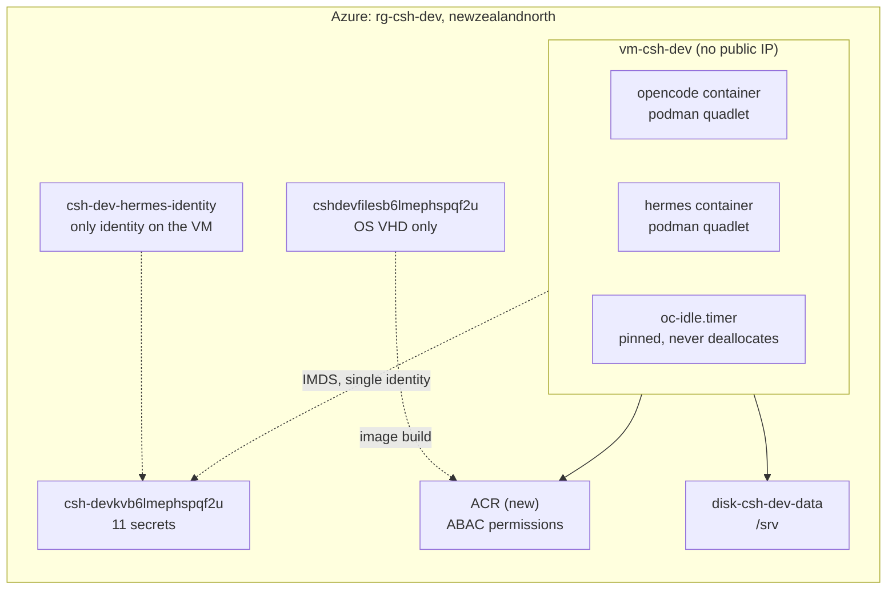
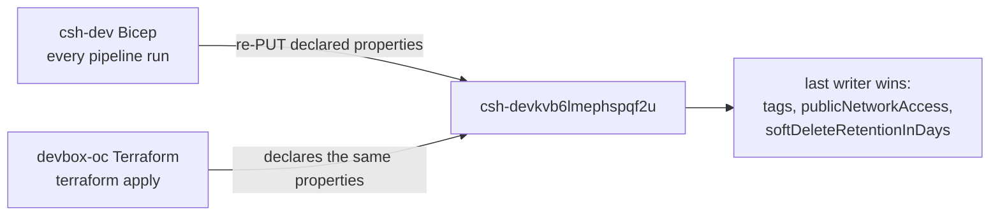

# Deployment plan: replace the ACA deployment with a Bicep-owned devbox VM

Status: draft decisions settled, pending review. Baseline: `main` at `b13eb1a`.
Nothing in this repo has ever run against a real Azure subscription.

Target: `rg-csh-dev` in `newzealandnorth`, subscription
`b44e1a7e-e9e1-4c4d-a9d0-028fb4515f51` (Pay-As-You-Go).

The shape has changed from "adopt the resource group into Terraform" to
"replace the Container Apps deployment with a VM, inside the Bicep that already
owns the resource group". The resource group, the vault and the identities stay.
The deployment mechanism changes hands.

---

## Who owns `rg-csh-dev` today

Read from Azure DevOps, not assumed. The owner is Bicep, in project
`AzureAppDev`, repo `csh-dev`, and it is deployed by pipeline.

| Fact | Evidence |
|---|---|
| Target scope is the existing resource group | `infra/main.bicep`: `targetScope = 'resourceGroup'` |
| Deployed by pipeline | `pipelines/azure-pipelines.yml`: `az deployment group create --resource-group rg-csh-dev --template-file infra/main.bicep` |
| Last change | 2026-10-21, PR 1183, `fix(hermes): seed the Discord gate and the model provider key into the profile .env` |
| The decision it encodes | `docs/decisions/0001-aca-over-vm.md`, status accepted, 2026-10-09 |

What that template declares, all of it in `rg-csh-dev` unless noted:

| Module | Declares |
|---|---|
| `modules/environment.bicep` | `csh-dev-logs`, `csh-dev-env` |
| `modules/storage.bicep` | `cshdevfilesb6lmephspqf2u`, shares `plane-state`, `augur-workspace`, `hermes-data` |
| `modules/keyvault.bicep` | `csh-devkvb6lmephspqf2u`, plus the role assignments |
| `modules/identity.bicep` | `csh-dev-plane-identity`, `csh-dev-hermes-identity` (when Hermes is on) |
| `modules/plane.bicep` | `csh-dev-plane` |
| `modules/hermes.bicep` | `csh-dev-hermes` |
| `modules/budget.bicep` | `csh-dev-monthly`, 200 NZD hard, alerts at 60 and 100 percent |

## Two corrections to earlier claims in this session

**The vault name is derivable, and I said it was not.** I claimed the vault
`csh-devkvb6lmephspqf2u` could not be reached by derivation and had to become an
input variable. That was true only of this repo's Terraform formula,
`sha256(var.subscription_id)` at `terraform/main.tf:272`. The real derivation is
Bicep's `uniqueString(resourceGroup().id)` in `infra/modules/keyvault.bicep`. It
produces 13 characters, so `csh-dev` + `kv` + `b6lmephspqf2u` is 22 characters,
exactly the live name. The same suffix produces `cshdevfilesb6lmephspqf2u` at 24
characters. No input variable is needed, and the whole "three suites depend on
it" branch of the previous plan is dead.

**No import step exists.** I said the resource group needed
`terraform import azurerm_resource_group.this`. In Bicep the resource group is
the deployment target, so there is no resource to import and no state to drift.

## Decisions taken

| # | Decision | Taken |
|---|---|---|
| 1 | Availability of Hermes | Pin the VM awake, 24/7 |
| 2 | Vault name | Moot. Bicep already derives the live name |
| 3 | Purge protection | Turn it on, permanently |
| 4 | Identity on the VM | Attach `csh-dev-hermes-identity` as the only identity |
| 5 | Rollback window | Container app stays defined one week plus one restart |
| 6 | ACR role mode | `AbacRepositoryPermissions`, matching the Terraform default |
| 7 | IaC ownership | Port the VM into `csh-dev` Bicep, retire the ACA modules |
| 8 | ADR | Supersede `0001-aca-over-vm.md` with a new ADR in `csh-dev` |
| 9 | Plan scope | This document, rewritten now |

Decision 1 is the one that changes the code. Pinning means the idle gate stops
doing anything useful, and that is a deliberate cost, not an oversight.

## Shape after this plan



Gone after this plan: `csh-dev-plane`, `csh-dev-env`, `csh-dev-logs`, and the
`hermes-data` share. Kept: the resource group, the vault, both identities, the
storage account, and the budget.

## What already exists

`az resource list -g rg-csh-dev --query "length(@)"` returns 8 entries: seven
top-level resources plus one child. The seven are what the portal shows.

| Resource | Name | Type | After this plan |
|---|---|---|---|
| Container Apps Environment | `csh-dev-env` | `Microsoft.App/managedEnvironments` | Delete, one cleanup step |
| Environment certificate | `csh-dev-env/cf-origin-ultus` | `managedEnvironments/certificates` | Goes with the environment |
| Container app | `csh-dev-hermes` | `Microsoft.App/containerApps` | Delete after the rollback window |
| Identity | `csh-dev-hermes-identity` | User-assigned identity | **Keep.** Becomes the VM identity |
| Identity | `csh-dev-plane-identity` | User-assigned identity | Retire with the plane |
| Key Vault | `csh-devkvb6lmephspqf2u` | Key Vault | **Keep.** 11 secrets |
| Log Analytics | `csh-dev-logs` | Workspace | Delete, one cleanup step |
| Storage account | `cshdevfilesb6lmephspqf2u` | Storage account | **Keep** for the OS VHD |

The resource group is the container for those eight, not an entry in the list.
There is no ACR anywhere in the subscription matching `csh`, so the template must
create one.

Shares, read with the ARM API: `hermes-data` is the migration source and is
deleted after cutover. `plane-state` and `augur-workspace` belong to the plane
and go with it. All three are `TransactionOptimized`, 16 GiB quota, SMB.

## Why replace rather than add

The VM must live in the same resource group as the vault and the identity. Two
tools writing that group is a real hazard, and the vault is where it lands.



Bicep declares `publicNetworkAccess: 'Enabled'`, `softDeleteRetentionInDays: 7`
and no `tags` on the vault. The Terraform at `terraform/main.tf:119-142` declares
all three. Whichever runs last resets the other, and neither plan expresses the
other's intent. The storage account and the three shares have the same problem.

One writer per resource group is the rule that removes this class of bug. Since
Bicep already holds the group and the vault, the VM goes into Bicep.

## The constraint that decides the cost model: idle

`oc-idle-check` deallocates the VM after 45 idle minutes. Its five busy signals
are all OpenCode API endpoints (`host/bin/oc-idle-check:93-121`), and its
container check asks only about `opencode.service`
(`host/bin/oc-idle-check:123-125`).

Hermes is a Discord gateway. It holds a websocket and answers at any hour. None
of those five signals can see it. Move Hermes onto the box unchanged and the box
deallocates under a live bot.

Decision 1 was pin the box awake, so this plan pins it and pays for it. The
mechanism already exists: `host/bin/oc-idle-check:47-50` exits early when
`/var/lib/oc-idle/pin` exists, and `/var/lib` persists across reboots. Ignition
creates that file at first boot.

Two honest notes about pinning:

- **The scheduled start becomes pointless.** With the box never deallocating,
  the Logic App in `terraform/schedule.tf:8` and its role assignment at
  `terraform/schedule.tf:21` wake a machine that is always awake. They are not
  ported.
- **The idle gate becomes dead code that still runs** every five minutes. Keeping
  it is deliberate: if Hermes ever leaves the box, removing one file restores
  cost control. Deleting it is a follow-up item, not part of this change.

## What the actuals say

October, `rg-csh-dev`, ActualCost, grouped by resource and meter, in NZD:

| Line | NZD |
|---|---|
| Azure Files `Standard Transactions` | 242.33 |
| Azure Files `LRS Write Operations` | 63.09 |
| `csh-dev-hermes` compute, all meters | 97.66 |
| `csh-dev-plane` compute, all meters | 39.67 |
| Azure Files reads, protocol, stored | 12.91 |
| `csh-devkvb6lmephspqf2u` | 0.03 |
| **Total** | **455.64** |

Against the live budget of 200 NZD hard, that is 2.3 times over, with alerts
already configured at 60 and 100 percent.

Two conclusions, both measured:

- **The transaction line is not stored bytes.** `LRS Data Stored` is 0.07 NZD.
  The 242.33 NZD is SMB mount churn: at file-service scope the `Transactions`
  metric runs at about 136,000 per hour, every hour, and the `ApiName` breakdown
  is dominated by `Create`, `Close` and `QueryInfo`. Moving Hermes state to the
  local data disk removes Hermes' share of that class. I cannot state a number
  for Hermes alone, because the `FileShare` dimension returns `<All>` at
  file-service scope, so the saving is a prediction to verify after cutover, not
  a claim.
- **The budget must move in the same change.** A 24/7 `Standard_B2as_v2` is
  0.0998 USD/hour, about 130 NZD/month at 1 USD = 1.7773 NZD. That alone is most
  of the current soft threshold. Leaving the budget at 200 guarantees another
  false alarm.

## The impedance points, worked out

This is where a naive port fails. Each was checked against the file it concerns.

### 1. The identity is gated on Hermes being deployed

`infra/main.bicep` creates the Hermes identity inside
`module hermesIdentity ... = if (deployHermes)`. Retiring the container app sets
`deployHermes=false`, and the identity the VM now depends on would be deleted
with it. The section that removes the app must not remove the identity.

**Fix:** move the identity out of the `deployHermes` condition and give it its
own module call with no gate, before the VM module consumes `identityId`. The
resource name `csh-dev-hermes-identity` must not change, because that name is in
the live role assignment.

### 2. The `hermes-data` share is also gated on `deployHermes`

`infra/modules/storage.bicep` declares `hermesShare ... if (deployHermes)`.
Incremental mode leaves undeclared resources alone, so dropping the app does not
drop the share. That is what makes the rollback window possible: the container
app keeps writing its state while the VM is proven.

**Fix:** leave the share in place through the cutover, then delete it explicitly,
either by hand or through a deployment stack. Do not assume the template removal
deletes it.

### 3. Ignition cannot be rendered inside the template

`os/butane/build.sh:9` requires `VAULT_NAME`, `ACR_NAME`, `DISK_ID`, `RG`,
`SUBSCRIPTION_ID` and `SSH_PUBKEY`, and substitutes them into `ucore.ign`. The
vault and storage names come from `uniqueString()`, which is an ARM function with
no faithful offline equivalent, so the build script cannot reproduce them.

**Fix:** two-stage deployment in one pipeline run.

1. Stage one deploys network, disk and ACR, and outputs the disk resource id.
2. The pipeline builds `ucore.ign` from those outputs.
3. Stage two deploys the VM with `customData` as a parameter.

`loadFileAsBase64` has a 96 KB limit, and the current `os/butane/ucore.ign` is
18,569 bytes, about 24.2 KB base64, so it fits. Use a generated parameters file
rather than an inline argument, because the base64 will not survive shell
quoting at that size.

**Stop if** the Ignition grows past roughly 70 KB, because base64 plus JSON
escaping starts crowding the limit.

### 4. The OS image id is produced by this repo's pipeline

`os/build-os-image.sh:108` prints the image id and
`pipelines/devbox-os.yml:15-17` still names `rg-devbox-oc`,
`stdevboxocimages` and `westeurope`. The image is built by `devbox-oc`, so the
Bicep cannot compute the id. It becomes a required parameter with no default, so
a deploy without it fails instead of booting a stale image.

Keep `os/build-os-image.sh:77,80` and the `--bootc-default-fs ext4` argument.
Keep the `sha256sum` provenance line at `:96`.

### 5. ACR role mode uses ARM enum names, not CLI names

`az acr create --role-assignment-mode` takes `rbac` or `rbac-abac`. The Bicep
property `roleAssignmentMode` takes `AbacRepositoryPermissions` or
`LegacyRegistryPermissions`. Using the CLI spelling in Bicep validates and then
fails at deploy.

**Fix:** set `AbacRepositoryPermissions` explicitly, and grant the VM identity
`Container Registry Repository Reader` (`b93aa761-3e63-49ed-ac28-beffa264f7ac`).
Do not grant `AcrPull` (`7f951dda-4ed3-4680-a7ca-43fe172d538d`), which ABAC mode
ignores.

### 6. Egress costs money while the box is deallocated

The Terraform subnet sets `default_outbound_access_enabled = false`
(`terraform/main.tf:23`), so an explicit egress method is mandatory, and it chose
a NAT gateway plus a static public IP (`terraform/main.tf:68-77`).

Those bill by the hour whether or not the VM is running. The retail API prices a
standard NAT gateway at 0.045 USD/hour and a static IP at 0.006 USD/hour, so
roughly 37 USD, about 66 NZD, per month with the VM stopped. That is real money
against a 200 NZD budget and it buys nothing while the box is pinned anyway.

The retail API returns NAT gateway pricing in the `Global` region only, with no
`newzealandnorth` row, so treat 0.045 as indicative and confirm against the
invoice. Simpler alternative to evaluate at implementation: leave
`defaultOutboundAccess` at its default for this subnet, which removes both
charges. Verify against the subscription's March 2026 private-subnet default
before relying on it.

## Phase 0: what you hold

| Item | Why | Check |
|---|---|---|
| Rights on `csh-dev` in `AzureAppDev` | the change lands there | you can open a PR on `main` |
| Rights to grant roles at RG scope | the template assigns roles to two principals | you can grant User Access Administrator |
| Tailscale tailnet plus a reusable auth key | the only data path | admin console |
| `hermes-data` read access | migration source | `Storage File Data SMB Share Reader` or the account key |
| Azure DevOps service connection | the pipeline authenticates twice | `jhl-agent-service-connection` present |

`hermes-data` is an Azure Files share. My identity has neither the SMB share role
nor the account key, so the state copy in Phase 6 is yours or needs a grant.

## Phase 1: establish the baseline and supersede the ADR

1. **Record the actuals** in the new ADR: 455.64 NZD against the 200 hard budget.
   That is the fired revisit trigger in `0001-aca-over-vm.md`, which lists
   "sustained mostly-active load pushes both apps past the hard budget alert".
2. **Write `docs/decisions/0002-vm-over-aca.md`** in `csh-dev`, citing 0001 as
   superseded, with the measured numbers and the accepted cost of pinning.
3. **Run `az deployment group what-if`** on the current template and store the
   output with the ADR. This is the record of what the baseline actually is.

**Check:** the ADR names 455.64, 242.33 and 200, and `what-if` reports no changes
on an unchanged template.

**Stop if** `what-if` reports changes on an unchanged template. That means the
committed Bicep does not match the deployed state, and the whole plan is built on
a false baseline.

## Phase 2: port the infrastructure modules

New modules in `csh-dev/infra/modules`, ported from the Terraform that already
encodes these invariants. Each invariant keeps a guard, because a rule with no
reader is a rule that drifts.

| New module | Ports from | Invariant to keep |
|---|---|---|
| `network.bicep` | `terraform/main.tf:7-117` | No public IP on the NIC; inbound deny from Internet |
| `disk.bicep` | `terraform/main.tf:192-204` | 128 GiB `StandardSSD_LRS`, must survive a VM rebuild |
| `acr.bicep` | Phase 1 of the old plan | ABAC mode, Basic SKU |
| `vm.bicep` | `terraform/main.tf:144-210` | ucore image, Ignition custom data, user-assigned identity only |
| `roles.bicep` | `terraform/main.tf:241-292` | KV Secrets User, self power, disk snapshot, ACR pull |

Compose them in `infra/main.bicep` after the existing modules.

Rename nothing that exists. The vault name, storage account, share names and both
identity names are referenced by live role assignments and by the running container
app; a rename is an outage, not a refactor.

**Check:** `bicep build infra/main.bicep` produces no warnings, and
`az deployment group what-if` reports the VM, disk, NIC, NSG and ACR as the only
creates.

**Stop if** `what-if` reports modify or delete on the vault, the storage account
or either identity.

## Phase 3: publish the OS image and the container image

Unchanged from this repo, with the adopted names.

1. Set `resourceGroup: rg-csh-dev` and `storageAccount: cshdevfilesb6lmephspqf2u`
   in `pipelines/devbox-os.yml:15-16`.
2. Run the OS pipeline. Record the image id, the VHD sha256, and
   `az image show -n <name> -g rg-csh-dev --query hyperVGeneration`.
3. Set `acrName` in `pipelines/devbox-image.yml:9` to the new registry, and run
   it before the first boot, because `host/quadlet/opencode.container:17` points
   at `:prod`, which does not exist until this phase.

**Check:** image id matches `^/subscriptions/.+/providers/Microsoft.Compute/images/.+$`,
`hyperVGeneration` is `V2`, and `az acr repository show-tags` lists `prod`.

**Stop if** the builder fails. Likely causes, in order: podman storage not shared
with the builder container, bootc ref not in local storage, missing declared root
filesystem, which `--bootc-default-fs ext4` at `os/build-os-image.sh:77,80` covers.

## Phase 4: deploy the VM, two stages

1. **Stage one:** deploy network, disk and ACR. Capture the disk resource id from
   the deployment output.
2. **Build Ignition** with the stage-one outputs plus the OS image id:
   `./os/butane/build.sh` in this repo.
3. **Stage two:** deploy the VM with `customData` from the generated parameters
   file. Pin `imageReference.id` to the Phase 3 image id as a required parameter.

**Check:** `grep -c placeholder os/butane/ucore.ign` returns 0, and the deployed
VM has no public IP: `az vm show -n vm-csh-dev -g rg-csh-dev --query
"{nic:networkProfile.networkInterfaces[0].id}"` then confirm the NIC has no
`publicIpAddress` block.

**Stop if** the VM resource is recreated on a later apply. Bicep re-applies all
properties on redeploy, and a changed `customData` rolls the VM. That is safe
only because the data disk is a separate resource, and it is not safe until the
disk is verified unattached to the OS lifecycle.

## Phase 5: verify the boot

```
ssh core@devbox "sudo rpm-ostree status"
ssh core@devbox "systemctl is-active tailscaled oc-secrets oc-tailnet opencode"
ssh core@devbox "systemctl is-enabled tailscaled"
ssh core@devbox "sudo podman ps --format '{{.Names}} {{.Status}}'"
ssh core@devbox "test -e /var/lib/oc-idle/pin && echo pinned"
```

**Check:** the booted deployment names `ucore-minimal`, all four units are
active, `tailscaled` is enabled, the container is healthy, and the pin file
exists.

**Stop if** `rpm-ostree status` names `fedora-coreos`. Wrong image, and every host
unit assumes ucore packages.

## Phase 6: migrate Hermes onto the VM

A migration, because Hermes works today. `az containerapp show` reports
`runningStatus: Running`, `provisioningState: Succeeded`, revision
`csh-dev-hermes--0000008`.

**Order matters: add before remove.** The container app keeps serving Discord
until the quadlet has served long enough to trust.

1. **Move the state.** Copy `hermes-data` to `/srv/hermes` on the data disk. The
   app mounts `/opt/data` today, so the quadlet keeps that path and only the
   backing store changes.
2. **Write the quadlet.** Same image pinned by digest
   (`nousresearch/hermes-agent@sha256:55e192fb...`), same args
   (`gateway run`), same `WORKFLOW_PLANE_URL`, and the two secrets fetched from
   Key Vault by the `oc-secrets` pattern rather than baked into the unit. The VM
   carries exactly one identity, `csh-dev-hermes-identity`, so
   `host/bin/lib-imds.sh:9` resolves without a `client_id` and needs no change.
   Two identities on one VM would make that call ambiguous.
3. **Run it beside OpenCode.** `podman ps` shows both healthy.
4. **Cut over Discord.** Stop the container app, then watch the bot answer from
   the VM. Do not delete the app.
5. **Retire after the window.** One week of real traffic plus one VM restart, then
   delete `csh-dev-hermes`, then the `hermes-data` share.

**Check:** a Discord message is answered with the container app stopped, and the
answer survives a VM restart.

**Stop if** the bot answers while the container app is still running after
cutover. Two gateways on one token duplicate replies.

## Phase 7: remove the Container Apps deployment

Only after Phase 6 step 5.

1. Delete `modules/plane.bicep`, `modules/hermes.bicep`, `modules/jobs.bicep`,
   `modules/aca-storage.bicep`, `modules/environment.bicep`, and their module
   calls in `infra/main.bicep`.
2. Delete the now-unused parameters in `infra/params/dev.bicepparam`, including
   `planeCustomHostnames`, `customDomainCertificateId`, the Hermes recipe, and
   the worker recipe.
3. Delete the `Plane` and `Hermes` stages from `pipelines/azure-pipelines.yml`.
4. Delete `scripts/resolve-plane-image.sh` and `scripts/verify-pin.sh` if nothing
   else calls them.
5. Delete `csh-dev-plane-identity` and the environment by hand or with a
   deployment stack, since incremental mode will not remove them.
6. **Raise the budget** in `modules/budget.bicep` to match the pinned cost, in the
   same PR.

**Check:** `what-if` reports no changes after the removal, the resource group
holds only the resources this plan intends, and the budget amount reflects a
24/7 VM.

**Stop if** the budget change lands after the removal. A removal that lowers cost
and a pin that raises it must not straddle a month boundary separately.

## Phase 8: prove recovery, then close the gaps

1. **Rebuild proof.** Redeploy the VM, confirm `/srv` returns with `/srv/hermes`.
2. **Snapshot proof.** Run `oc-snapshot`, then the restore drill at
   `docs/runbook.md:232-285` against a throwaway disk.
3. **Cost proof.** Read the next month's actuals against the new budget, and
   confirm the Files transaction line falls as predicted.

Then file these as work items:

- Delete the idle gate, or keep it, now that pinning makes it a no-op.
- Decide the NAT gateway, per impedance point 6.
- The dead `WORKFLOW_PLANE_URL`. Anything Hermes routes through the plane stays
  unavailable until a plane exists again.
- `podman auto-update` has no idle gate, so an update can restart the bot at any
  hour. That mattered less when the box slept.

## What this plan does not cover

- Rebuilding the plane. Removing `csh-dev-plane` leaves its ingress hostnames
  doing nothing.
- Rotating the 11 vault secrets after the VM is live.
- A second devbox. Nothing here is parameterised for two VMs in one resource
  group; the names are fixed.
- The `test-seed-config.sh` and `mutation-check.sh` coverage in `csh-dev`, which
  becomes dead when the Hermes init container goes. Deleting tests needs its own
  justification, not a footnote.
