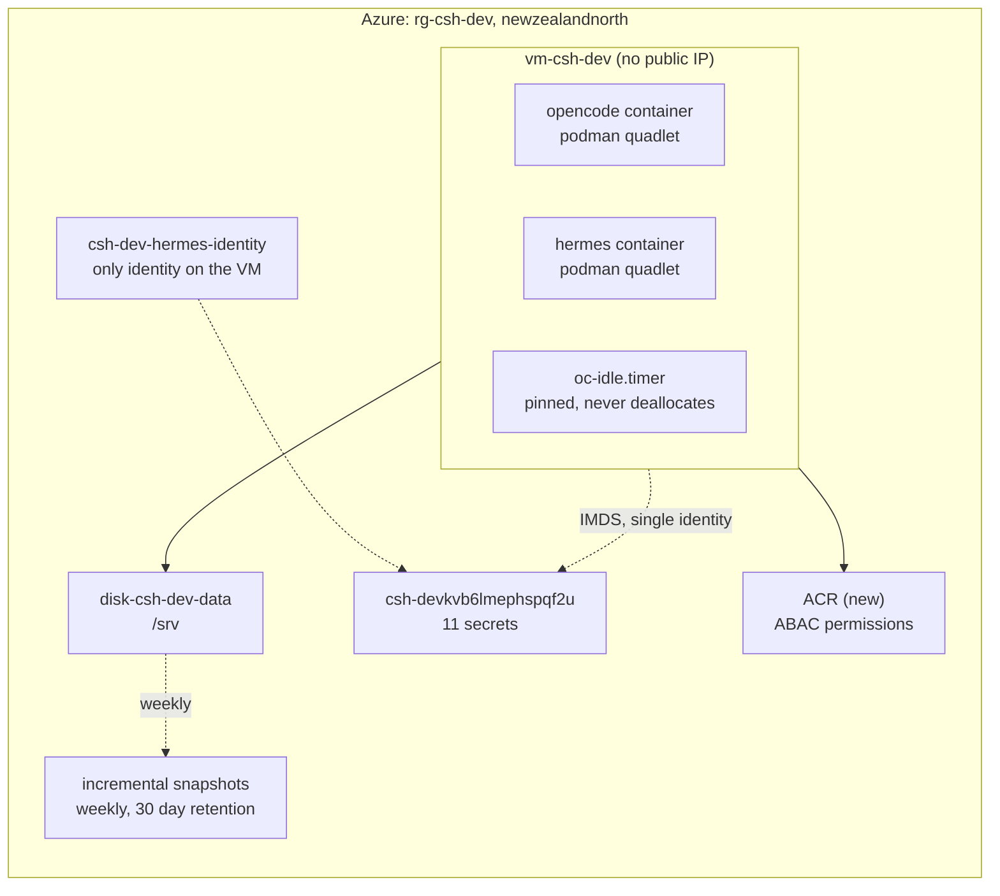
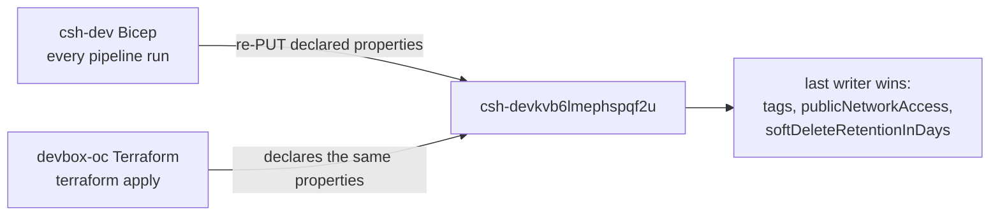

# Deployment plan: replace the ACA deployment with a Bicep-owned devbox VM

Status: draft decisions settled, pending review. Baseline: `main` at `b13eb1a`.
Nothing in this repo has ever run against a real Azure subscription.

Target: `rg-csh-dev` in `newzealandnorth`, subscription
`b44e1a7e-e9e1-4c4d-a9d0-028fb4515f51` (Pay-As-You-Go).

The shape has changed from "adopt the resource group into Terraform" to
"replace the Container Apps deployment with a VM, inside the Bicep that already
owns the resource group". The resource group, the vault and the identities stay.
The deployment mechanism changes hands.

---

## Who owns `rg-csh-dev` today

Read from Azure DevOps, not assumed. The owner is Bicep, in project
`AzureAppDev`, repo `csh-dev`, and it is deployed by pipeline.

| Fact | Evidence |
|---|---|
| Target scope is the existing resource group | `infra/main.bicep`: `targetScope = 'resourceGroup'` |
| Deployed by pipeline | `pipelines/azure-pipelines.yml`: `az deployment group create --resource-group rg-csh-dev --template-file infra/main.bicep` |
| Last change | 2026-10-21, PR 1183, `fix(hermes): seed the Discord gate and the model provider key into the profile .env` |
| The decision it encodes | `docs/decisions/0001-aca-over-vm.md`, status accepted, 2026-10-09 |

What that template declares, all of it in `rg-csh-dev` unless noted:

| Module | Declares |
|---|---|
| `modules/environment.bicep` | `csh-dev-logs`, `csh-dev-env` |
| `modules/storage.bicep` | `cshdevfilesb6lmephspqf2u` and its three shares. **The account was deleted 2026-11-03, so this module must go** |
| `modules/keyvault.bicep` | `csh-devkvb6lmephspqf2u`, plus the role assignments |
| `modules/identity.bicep` | `csh-dev-plane-identity`, `csh-dev-hermes-identity` (when Hermes is on) |
| `modules/plane.bicep` | `csh-dev-plane` |
| `modules/hermes.bicep` | `csh-dev-hermes` |
| `modules/budget.bicep` | `csh-dev-monthly`, 200 NZD hard, alerts at 60 and 100 percent |

A pipeline run on this template today would recreate the storage account the
operator just deleted. That is the first hazard to remove, before any VM work.

## Two corrections to earlier claims in this session

**The vault name is derivable, and I said it was not.** I claimed the vault
`csh-devkvb6lmephspqf2u` could not be reached by derivation and had to become an
input variable. That was true only of this repo's Terraform formula,
`sha256(var.subscription_id)` at `terraform/main.tf:272`. The real derivation is
Bicep's `uniqueString(resourceGroup().id)` in `infra/modules/keyvault.bicep`. It
produces 13 characters, so `csh-dev` + `kv` + `b6lmephspqf2u` is 22 characters,
exactly the live name. The same suffix produces `cshdevfilesb6lmephspqf2u` at 24
characters. No input variable is needed, and the whole "three suites depend on
it" branch of the previous plan is dead.

**No import step exists.** I said the resource group needed
`terraform import azurerm_resource_group.this`. In Bicep the resource group is
the deployment target, so there is no resource to import and no state to drift.

## Decisions taken

| # | Decision | Taken |
|---|---|---|
| 1 | Availability of Hermes | Pin the VM awake, 24/7 |
| 2 | Vault name | Moot. Bicep already derives the live name |
| 3 | Purge protection | Turn it on, permanently |
| 4 | Identity on the VM | Attach `csh-dev-hermes-identity` as the only identity |
| 5 | Rollback window | Container app stays defined one week plus one restart |
| 6 | ACR role mode | `AbacRepositoryPermissions`, matching the Terraform default |
| 7 | IaC ownership | Port the VM into `csh-dev` Bicep, retire the ACA modules |
| 8 | ADR | Supersede `0001-aca-over-vm.md` with a new ADR in `csh-dev` |
| 9 | Plan scope | This document, rewritten now |
| 10 | Egress | No NAT gateway, no static IP. `defaultOutboundAccess: true` |
| 11 | Storage | No storage account. Data disk plus snapshots only |
| 12 | Backup model | Git and Azure DevOps are the backup. Snapshots are an undo |
| 13 | Snapshots | Weekly, 30 day retention |
| 14 | Budget | Stay at 200. The new shape prices at 183 to 193 |

Decisions 1 and 12 are the two that change the code. Pinning makes the idle gate a
no-op, and treating git as the backup is what makes weekly snapshots enough rather
than nightly ones.

Decision 14 is the one to hold me to. The previous version of this plan proposed
raising the budget to cover the pinned cost, which would have hidden a 246 NZD
design behind a bigger number. The budget does not move.

## Shape after this plan



There is no storage account in this shape. It was deleted on 2026-11-03, taking
the three shares and the `workflow-evidence` blobs with it. That removes the
migration source and the image staging path, so the plan no longer has either.

Gone after this plan: `csh-dev-env`, `csh-dev-logs`, `csh-dev-hermes`, and
`csh-dev-plane-identity`. Kept: the resource group, the vault,
`csh-dev-hermes-identity`, and the budget.

## What already exists

Read with `az resource list -g rg-csh-dev` on 2026-11-03, after the storage
account deletion. Six entries, five top-level plus one child.

| Resource | Name | Type | After this plan |
|---|---|---|---|
| Container Apps Environment | `csh-dev-env` | `Microsoft.App/managedEnvironments` | Delete, one cleanup step |
| Environment certificate | `csh-dev-env/cf-origin-ultus` | `managedEnvironments/certificates` | Goes with the environment |
| Container app | `csh-dev-hermes` | `Microsoft.App/containerApps` | Delete after the rollback window |
| Identity | `csh-dev-hermes-identity` | User-assigned identity | **Keep.** Becomes the VM identity |
| Key Vault | `csh-devkvb6lmephspqf2u` | Key Vault | **Keep.** 11 secrets |
| Log Analytics | `csh-dev-logs` | Workspace | Delete, one cleanup step |

`csh-dev-plane` and `csh-dev-plane-identity` were already gone before this edit,
and the storage account went with the shares and the blob container. There is no
ACR anywhere in the subscription matching `csh`, so the template creates one.

**The Hermes state is already lost.** `hermes-data` was the only copy, so there
is nothing to copy in Phase 6 and no rollback of that data. Hermes still reports
`Running` with no restarts through 2026-11-03 02:00, which means either it keeps
no durable state on that mount or it has not needed to read one yet. Treat the
first boot as a fresh start.

## Why replace rather than add

The VM must live in the same resource group as the vault and the identity. Two
tools writing that group is a real hazard, and the vault is where it lands.



Bicep declares `publicNetworkAccess: 'Enabled'`, `softDeleteRetentionInDays: 7`
and no `tags` on the vault. The Terraform at `terraform/main.tf:119-142` declares
all three. Whichever runs last resets the other, and neither plan expresses the
other's intent. The storage account and the three shares have the same problem.

One writer per resource group is the rule that removes this class of bug. Since
Bicep already holds the group and the vault, the VM goes into Bicep.

## The constraint that decides the cost model: idle

`oc-idle-check` deallocates the VM after 45 idle minutes. Its five busy signals
are all OpenCode API endpoints (`host/bin/oc-idle-check:93-121`), and its
container check asks only about `opencode.service`
(`host/bin/oc-idle-check:123-125`).

Hermes is a Discord gateway. It holds a websocket and answers at any hour. None
of those five signals can see it. Move Hermes onto the box unchanged and the box
deallocates under a live bot.

Decision 1 was pin the box awake, so this plan pins it and pays for it. The
mechanism already exists: `host/bin/oc-idle-check:47-50` exits early when
`/var/lib/oc-idle/pin` exists, and `/var/lib` persists across reboots. Ignition
creates that file at first boot.

Two honest notes about pinning:

- **The scheduled start becomes pointless.** With the box never deallocating,
  the Logic App in `terraform/schedule.tf:8` and its role assignment at
  `terraform/schedule.tf:21` wake a machine that is always awake. They are not
  ported.
- **The idle gate becomes dead code that still runs** every five minutes. Keeping
  it is deliberate: if Hermes ever leaves the box, removing one file restores
  cost control. Deleting it is a follow-up item, not part of this change.

## What the actuals say, and what the new shape costs

October, `rg-csh-dev`, ActualCost grouped by resource and meter, in NZD. These
are the numbers that fired the budget, and they are history: the storage account
and the plane are already gone, so the Files line is zero from 2026-11-03.

| Line | NZD | Still billed after this change |
|---|---|---|
| Azure Files `Standard Transactions` | 242.33 | No, account deleted |
| Azure Files `LRS Write Operations` | 63.09 | No, account deleted |
| `csh-dev-hermes` compute, all meters | 97.66 | No, replaced by the VM |
| `csh-dev-plane` compute, all meters | 39.67 | No, already deleted |
| Azure Files reads, protocol, stored | 12.91 | No, account deleted |
| `csh-devkvb6lmephspqf2u` | 0.03 | Yes |
| **Total** | **455.64** | |

The new shape, priced at retail for `newzealandnorth` from the Azure Retail
Prices API, 730 hours, 1 USD = 1.7773 NZD (frankfurter.app, 2026-11-02):

| Line | SKU | USD | NZD/month |
|---|---|---|---|
| Compute | `Standard_B2as_v2`, 2 vCPU / 8 GiB | 0.0998/hr | 129.48 |
| Data disk | `E10`, 128 GiB StandardSSD_LRS | 13.7088/mo | 24.36 |
| OS disk | `P6`, 64 GiB Premium_LRS | 10.207/mo | 18.14 |
| ACR | Basic registry | 0.1666/day | 9.01 |
| Key Vault | 11 secrets, standard | | 0.03 |
| Egress | default outbound access | 0 | 0 |
| NAT gateway | **not deployed** | | 0 |
| Static IP | **not deployed** | | 0 |
| **Subtotal** | | | **181.02** |
| Snapshots, weekly, 30 day retention | estimate, changed blocks | | 2 to 12 |
| **Total** | | | **183 to 193** |

Against the 200 NZD budget, that is under it, with roughly 10 to 17 NZD of
headroom. The compute is 129 of the 181, so the only large lever left is the SKU.

Three conclusions, each measured:

- **The transaction line was never stored bytes.** `LRS Data Stored` was 0.07 NZD.
  The 242.33 NZD was 65,439,848 SMB operations at 0.0370 NZD per 10K, dominated by
  `Create`, `Close` and `QueryInfo` at about 136,700 an hour around the clock.
- **That traffic was Hermes, not the plane.** I said earlier I could not attribute
  it. That was wrong, and the deletion settled it: `csh-dev-plane` is gone from the
  resource group, and the rate did not move, 135,682 in the 18:00 hour on
  2026-11-02 against 136,672 on 2026-10-20 when both apps ran. With the plane gone,
  `hermes-data` was the only mounted share. The shape is 12 file Creates and 12
  Closes a second with almost no Writes, which is a polling loop, not storage.
- **The VM is not the saving.** The compute is 129.48, against 137.33 for both
  container apps. The saving is 318 NZD of Files transactions that disappear
  because a VM has a disk next to it, and a container app does not.

### The NAT gateway, deleted

`terraform/main.tf:23` sets `default_outbound_access_enabled = false`, which is a
choice this repo made, not a platform requirement. Microsoft states the opposite:

> You can still configure subnets as nonprivate using any supported method (ARM
> templates, portal, CLI, PowerShell).

That comment on the Terraform was carried into the first version of this plan as
if it were a requirement, and the NAT gateway plus static IP it forced costs
64.87 NZD/month. Nothing needs it: Tailscale dials out, needs no inbound path and
no stable egress address, and `defaultOutboundAccess: true` attaches no public IP
to the resource, so `terraform/tests/no_public_ip.sh` still passes.

Set `defaultOutboundAccess: true` explicitly in the subnet resource. Do not omit
the property: subnets created against an API version after 2026-03-31 default to
`false`, and the failure is a VM with no egress at all.

### Snapshots are an undo, not a backup

Git and Azure DevOps are the backup. `docs/runbook.md:227-230` already says this
and the wording was right: the data disk is not a backup, and anything you would
grieve over must be pushed to a remote.

What the data disk holds beyond a remote is uncommitted work: `/srv/repos` before
a push, and `/srv/opencode/state`, which is the session database and is expensive
to rebuild rather than irreplaceable. Snapshots exist for those, and for the case
where a bad change corrupts the disk mid-session.

That lowers what they are worth. The rate is 0.132 USD/GB-month for changed
blocks, weekly is enough for an uncommitted-work undo, and the retention carries
the cost:

| Schedule | Runs held in 30 days | Changed per run | NZD/month |
|---|---|---|---|
| Weekly, 30 day retention | 4 to 5 | 2 GB | 2.3 |
| Weekly, 30 day retention | 4 to 5 | 10 GB | 11.7 |
| Nightly, 30 day retention | 30 | 2 GB | 14.1 |
| Nightly, no retention (today) | grows without limit | 2 GB | 14.1 and rising |

Weekly plus 30 days is the operator decision, and it is the right one under a
git-backup model: 2.3 to 11.7 NZD/month instead of a line that only grows, and
the loss it accepts is up to seven days of uncommitted work rather than one. If
that is too much to lose, the fix is a push, not a denser snapshot schedule.

`host/bin/oc-snapshot` creates only. The retention rule is new work: delete
snapshots older than 30 days in the same job, after the newest one is verified.

## The impedance points, worked out

This is where a naive port fails. Each was checked against the file it concerns.

### 1. The identity is gated on Hermes being deployed

`infra/main.bicep` creates the Hermes identity inside
`module hermesIdentity ... = if (deployHermes)`. Retiring the container app sets
`deployHermes=false`, and the identity the VM now depends on would be deleted
with it. The section that removes the app must not remove the identity.

**Fix:** move the identity out of the `deployHermes` condition and give it its
own module call with no gate, before the VM module consumes `identityId`. The
resource name `csh-dev-hermes-identity` must not change, because that name is in
the live role assignment.

### 2. The `hermes-data` share is also gated on `deployHermes`

Moot, and worth recording as such. `infra/modules/storage.bicep` declared
`hermesShare ... if (deployHermes)`, and the point was that incremental mode would
leave it in place so the container app could keep writing during the rollback
window. The share and the whole storage account were deleted on 2026-11-03, so
there is nothing to preserve and no rollback data.

**Fix:** delete `modules/storage.bicep` and its shares from the template entirely.
Incremental mode will not recreate a resource that is no longer declared, but it
will recreate the account if the module stays.

### 3. Ignition cannot be rendered inside the template

`os/butane/build.sh:9` requires `VAULT_NAME`, `ACR_NAME`, `DISK_ID`, `RG`,
`SUBSCRIPTION_ID` and `SSH_PUBKEY`, and substitutes them into `ucore.ign`. The
vault name comes from `uniqueString()`, which is an ARM function with no faithful
offline equivalent, so the build script cannot reproduce it.

**Fix:** two-stage deployment in one pipeline run.

1. Stage one deploys network, disk and ACR, and outputs the disk resource id.
2. The pipeline builds `ucore.ign` from those outputs.
3. Stage two deploys the VM with `customData` as a parameter.

`loadFileAsBase64` has a 96 KB limit, and the current `os/butane/ucore.ign` is
18,569 bytes, about 24.2 KB base64, so it fits. Use a generated parameters file
rather than an inline argument, because the base64 will not survive shell
quoting at that size.

**Stop if** the Ignition grows past roughly 70 KB, because base64 plus JSON
escaping starts crowding the limit.

### 4. The OS image id is produced by this repo's pipeline

`os/build-os-image.sh:108` prints the image id and
`pipelines/devbox-os.yml:15-17` still names `rg-devbox-oc`,
`stdevboxocimages` and `westeurope`. The image is built by `devbox-oc`, so the
Bicep cannot compute the id. It becomes a required parameter with no default, so
a deploy without it fails instead of booting a stale image.

Keep `os/build-os-image.sh:77,80` and the `--bootc-default-fs ext4` argument.
Keep the `sha256sum` provenance line at `:96`.

### 5. ACR role mode uses ARM enum names, not CLI names

`az acr create --role-assignment-mode` takes `rbac` or `rbac-abac`. The Bicep
property `roleAssignmentMode` takes `AbacRepositoryPermissions` or
`LegacyRegistryPermissions`. Using the CLI spelling in Bicep validates and then
fails at deploy.

**Fix:** set `AbacRepositoryPermissions` explicitly, and grant the VM identity
`Container Registry Repository Reader` (`b93aa761-3e63-49ed-ac28-beffa264f7ac`).
Do not grant `AcrPull` (`7f951dda-4ed3-4680-a7ca-43fe172d538d`), which ABAC mode
ignores.

### 6. Egress: no NAT gateway, no static IP

The Terraform subnet sets `default_outbound_access_enabled = false`
(`terraform/main.tf:23`), so it needed an explicit egress method and chose a NAT
gateway plus a static public IP (`terraform/main.tf:68-77`).

That flag is a choice this repo made. Microsoft documents the alternative plainly:
"You can still configure subnets as nonprivate using any supported method (ARM
templates, portal, CLI, PowerShell)." Set `defaultOutboundAccess: true` and the
subnet provides egress with no gateway and no address.

| | NAT gateway + static IP | `defaultOutboundAccess: true` |
|---|---|---|
| Hourly charge | 0.045 + 0.006 USD | 0 |
| Monthly, NZD | 64.87 | 0 |
| Public IP on the NIC | none | none |
| Inbound path | none | none |
| Egress address stable | yes | no, Microsoft-owned |
| Tailscale | works | works |

Nothing in this design needs a stable egress address. Tailscale dials out from the
host, accepts no inbound connection, and resolves peers by name on the tailnet. The
fixed address buys nothing, so it is not ported.

The NAT gateway rate is a `Global` retail row, since there is no
`newzealandnorth` row for it, so treat 0.045 as indicative. The static IP rate is
regional and measured.

**Set the property explicitly.** Omitting `defaultOutboundAccess` is not the same
as `true`: subnets created against an API version after 2026-03-31 default to
`false`, and the symptom is a VM that boots with no egress at all. The NSG still
denies inbound from the Internet, and no public IP is attached, so
`terraform/tests/no_public_ip.sh` keeps passing.

## Phase 0: what you hold

| Item | Why | Check |
|---|---|---|
| Rights on `csh-dev` in `AzureAppDev` | the change lands there | you can open a PR on `main` |
| Rights to grant roles at RG scope | the template assigns roles to two principals | you can grant User Access Administrator |
| Tailscale tailnet plus a reusable auth key | the only data path | admin console |
| Azure DevOps service connection | the pipeline authenticates twice | `jhl-agent-service-connection` present |

The `hermes-data` row is gone from the previous version: the share no longer
exists, so there is no migration source to read and nothing needs an SMB role or
the account key.

## Phase 1: establish the baseline and supersede the ADR

1. **Record the actuals** in the new ADR: 455.64 NZD against the 200 hard budget.
   That is the fired revisit trigger in `0001-aca-over-vm.md`, which lists
   "sustained mostly-active load pushes both apps past the hard budget alert".
2. **Write `docs/decisions/0002-vm-over-aca.md`** in `csh-dev`, citing 0001 as
   superseded, with the measured numbers and the accepted cost of pinning.
3. **Run `az deployment group what-if`** on the current template and store the
   output with the ADR. This is the record of what the baseline actually is.

**Check:** the ADR names 455.64, 242.33 and 200, and `what-if` reports no changes
on an unchanged template.

**Stop if** `what-if` reports changes on an unchanged template. That means the
committed Bicep does not match the deployed state, and the whole plan is built on
a false baseline.

## Phase 2: port the infrastructure modules

New modules in `csh-dev/infra/modules`, ported from the Terraform that already
encodes these invariants. Each invariant keeps a guard, because a rule with no
reader is a rule that drifts.

| New module | Ports from | Invariant to keep |
|---|---|---|
| `network.bicep` | `terraform/main.tf:7-117` | No public IP on the NIC; inbound deny from Internet; `defaultOutboundAccess: true` set explicitly |
| `disk.bicep` | `terraform/main.tf:192-204` | 128 GiB `StandardSSD_LRS`, must survive a VM rebuild |
| `acr.bicep` | Phase 1 of the old plan | ABAC mode, Basic SKU |
| `vm.bicep` | `terraform/main.tf:144-210` | ucore image, Ignition custom data, user-assigned identity only |
| `roles.bicep` | `terraform/main.tf:241-292` | KV Secrets User, self power, disk snapshot, ACR pull |
| `backup.bicep` | `host/bin/oc-snapshot` | weekly snapshot, keep 30 days |

Compose them in `infra/main.bicep` after the existing modules.

Rename nothing that exists. The vault name and both identity names are referenced
by live role assignments; a rename is an outage, not a refactor. The storage
account is already deleted, so `modules/storage.bicep` and every share in it must
be removed from the template in the same change, or a pipeline run recreates an
empty account nobody wants.

**Check:** `bicep build infra/main.bicep` produces no warnings, and
`az deployment group what-if` reports the VM, disk, NIC, NSG and ACR as the only
creates.

**Stop if** `what-if` reports modify or delete on the vault or either identity,
or reports a create for the storage account.

## Phase 3: publish the OS image and the container image

The storage account is gone, so the upload path changes. Do not recreate it for
this.

1. Build the VHD, then upload it to a managed disk instead of a blob:
   `az disk create -n <name> --upload-type Upload --upload-size-bytes <n>`, then
   `az disk grant-access` and upload, then `az image create --source <disk id>`.
   `az image create --source` accepts a managed disk id, so no blob URL is needed.
2. Drop `STORAGE_ACCOUNT` and the `az storage blob upload` call at
   `os/build-os-image.sh:101`, and set the region variables in
   `pipelines/devbox-os.yml:15-17` to `rg-csh-dev` and `newzealandnorth`.
3. Record the image id, the VHD sha256 from `os/build-os-image.sh:96`, and
   `az image show -n <name> -g rg-csh-dev --query hyperVGeneration`.
4. Set `acrName` in `pipelines/devbox-image.yml:9` to the new registry, and run
   it before the first boot, because `host/quadlet/opencode.container:17` points
   at `:prod`, which does not exist until this step.

**Check:** image id matches `^/subscriptions/.+/providers/Microsoft.Compute/images/.+$`,
`hyperVGeneration` is `V2`, and `az acr repository show-tags -n <acr> --repository devbox`
lists `prod`.

**Stop if** the builder fails. Likely causes, in order: podman storage not shared
with the builder container, bootc ref not in local storage, missing declared root
filesystem, which `--bootc-default-fs ext4` at `os/build-os-image.sh:77,80` covers.

## Phase 4: deploy the VM, two stages

1. **Stage one:** deploy the vnet, subnet with `defaultOutboundAccess: true`, NSG,
   disk, ACR and the weekly snapshot job. No NAT gateway and no public IP. Capture
   the disk resource id from the deployment output.
2. **Build Ignition** with the stage-one outputs plus the OS image id:
   `./os/butane/build.sh` in this repo.
3. **Stage two:** deploy the VM with `customData` from the generated parameters
   file. Pin `imageReference.id` to the Phase 3 image id as a required parameter.

**Check:** `grep -c placeholder os/butane/ucore.ign` returns 0, the deployed VM
has no public IP: `az vm show -n vm-csh-dev -g rg-csh-dev --query
"{nic:networkProfile.networkInterfaces[0].id}"` then confirm the NIC has no
`publicIpAddress` block, and the VM reaches the internet with no gateway:

```
ssh core@devbox "curl -fsS -o /dev/null -w '%{http_code}\n' https://login.microsoftonline.com"
```

**Stop if** the VM resource is recreated on a later apply. Bicep re-applies all
properties on redeploy, and a changed `customData` rolls the VM. That is safe
only because the data disk is a separate resource, and it is not safe until the
disk is verified unattached to the OS lifecycle.

## Phase 5: verify the boot

```
ssh core@devbox "sudo rpm-ostree status"
ssh core@devbox "systemctl is-active tailscaled oc-secrets oc-tailnet opencode"
ssh core@devbox "systemctl is-enabled tailscaled"
ssh core@devbox "sudo podman ps --format '{{.Names}} {{.Status}}'"
ssh core@devbox "test -e /var/lib/oc-idle/pin && echo pinned"
```

**Check:** the booted deployment names `ucore-minimal`, all four units are
active, `tailscaled` is enabled, the container is healthy, and the pin file
exists.

**Stop if** `rpm-ostree status` names `fedora-coreos`. Wrong image, and every host
unit assumes ucore packages.

## Phase 6: move Hermes onto the VM

There is no state to migrate. `hermes-data` was the only copy of whatever Hermes
kept there, and it was deleted with the storage account on 2026-11-03.

That is a data loss, and this plan does not pretend otherwise. What limits it:
the app still reports `Running`, healthy, one replica, zero restarts through
2026-11-03 02:00, with no requests served, so it is a gateway process rather than
a service holding user state. If it did keep a session database there, the next
Discord conversation starts empty.

**Order still matters: add before remove.** The container app keeps serving
Discord until the quadlet has served long enough to trust.

1. **Write the quadlet.** Same image pinned by digest
   (`nousresearch/hermes-agent@sha256:55e192fb...`), same args (`gateway run`),
   and the secrets fetched from Key Vault by the `oc-secrets` pattern rather than
   baked into the unit.
2. **Drop `WORKFLOW_PLANE_URL`.** It points at a deleted app, and the plane is not
   coming back in this plan. Leaving it set means Hermes retries a dead host.
3. **Mount `/srv/hermes` at `/opt/data`.** The app mounts `/opt/data` today, so
   the quadlet keeps that path and only the backing store changes.
4. **Run it beside OpenCode.** `podman ps` shows both healthy.
5. **Cut over Discord.** Stop the container app, then watch the bot answer from
   the VM. Do not delete the app.
6. **Retire after the window.** One week of real traffic plus one VM restart, then
   delete `csh-dev-hermes`.

The VM carries exactly one identity, `csh-dev-hermes-identity`, so
`host/bin/lib-imds.sh:9` resolves without a `client_id` and needs no change. Two
identities on one VM would make that call ambiguous.

**Check:** a Discord message is answered with the container app stopped, and the
answer survives a VM restart.

**Stop if** the bot answers while the container app is still running after
cutover. Two gateways on one token duplicate replies.

## Phase 7: remove the Container Apps deployment

Only after Phase 6 step 5.

1. Delete `modules/plane.bicep`, `modules/hermes.bicep`, `modules/jobs.bicep`,
   `modules/aca-storage.bicep`, `modules/environment.bicep`, and their module
   calls in `infra/main.bicep`.
2. Delete the now-unused parameters in `infra/params/dev.bicepparam`, including
   `planeCustomHostnames`, `customDomainCertificateId`, the Hermes recipe, and
   the worker recipe.
3. Delete the `Plane` and `Hermes` stages from `pipelines/azure-pipelines.yml`.
4. Delete `scripts/resolve-plane-image.sh` and `scripts/verify-pin.sh` if nothing
   else calls them.
5. Delete `csh-dev-plane-identity` and the environment by hand or with a
   deployment stack, since incremental mode will not remove them.
6. **Keep the budget at 200** unless the measured actuals land above it. The new
   shape prices at 183 to 193, so the existing 200 hard budget is correct and
   changing it would hide a regression.

**Check:** `what-if` reports no changes after the removal, the resource group
holds only the resources this plan intends, and the first full month's actual
lands under 200 without the budget being raised.

**Stop if** the first full month exceeds 200. That means a line in the table above
was underestimated, and the table is the thing to correct, not the budget.

## Phase 8: prove recovery, then close the gaps

1. **Rebuild proof.** Redeploy the VM, confirm `/srv` returns with `/srv/hermes`.
2. **Snapshot proof.** Run the weekly job, then the restore drill at
   `docs/runbook.md:232-285` against a throwaway disk. Confirm the retention rule
   deleted only snapshots older than 30 days.
3. **Cost proof.** Read the next month's actuals against the new budget, and
   confirm the shape lands at 183 to 193 rather than near 246.

Then file these as work items:

- Delete the idle gate, or keep it, now that pinning makes it a no-op.
- The dead `WORKFLOW_PLANE_URL`, which Phase 6 removes rather than points at a
  deleted host.
- `podman auto-update` has no idle gate, so an update can restart the bot at any
  hour. That mattered less when the box slept.
- The Hermes polling loop. 136,700 SMB operations an hour is now moot on a local
  disk, but the same loop still burns CPU and container time. It was never
  explained, only made cheaper.

## What this plan does not cover

- Rebuilding the plane. It is already deleted, along with its state shares, and
  this plan does not bring it back.
- The Hermes state that was on `hermes-data`. It was deleted with the storage
  account on 2026-11-03 and there is no copy to restore.
- Rotating the 11 vault secrets after the VM is live.
- A second devbox. Nothing here is parameterised for two VMs in one resource
  group; the names are fixed.
- The `test-seed-config.sh` and `mutation-check.sh` coverage in `csh-dev`, which
  becomes dead when the Hermes init container goes. Deleting tests needs its own
  justification, not a footnote.
