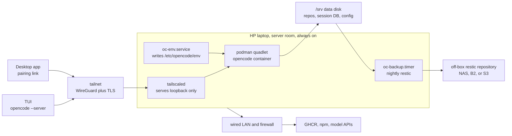

# Devbox: an always-on HP laptop running ucore and OpenCode

**Status:** approved for implementation
**Date:** 2026-11-05
**Supersedes:** the Azure VM design in git history before this change

## Intent

A personal AI development server that lives on a repurposed HP laptop in the
head-office server room. It runs ucore-minimal as an immutable Fedora CoreOS
host, runs the OpenCode server in a rootful podman container, and is reached
only over a private tailnet. The data disk is separate from the OS disk, and a
nightly restic backup leaves the box.

The goal is unchanged: stop fighting local environment drift by making the host
and the toolchain rebuildable artifacts. The host is now physical, always on,
and costs electricity instead of Azure compute.

## Why the pivot

The Azure design worked on paper but carried a control plane that the workload
did not need: Terraform, Key Vault, ACR, a Logic App, a NAT Gateway, managed disk
snapshots, Bastion, and an idle deallocator that existed only to reduce a bill.
Every one of those is a moving part with credentials, role assignments, and
failure modes. On a laptop in a server room, none of them earns its keep.

The pivot also removes the cost optimisation problem in `docs/headless-hosting-options.md`
(the deleted document). An always-on laptop has no scale-to-zero decision, no
ACA job-hours calculation, and no budget that makes a 4 GiB anchor necessary.

## Hardware

The host is a single HP laptop with these properties. Confirm them before an
install; the design fails loudly when one is missing.

| Property | Requirement | Why |
|---|---|---|
| CPU | x86_64, 4 cores or more | OpenCode, a container, and subagents run locally |
| RAM | 16 GiB or more | The measured idle server is small, but fan-out is not |
| OS disk | One internal SSD, at least 64 GiB | ucore is installed here and may be wiped on reinstall |
| Data disk | A second internal SSD, or a SATA SSD in a 2.5 inch bay | Sessions and repos must survive an OS reinstall |
| Network | Wired Ethernet | A server-room box should not depend on Wi-Fi |
| Firmware | UEFI, AC power-on after loss, lid-close ignore | A closed laptop must boot and stay awake unattended |
| Out-of-band | Intel AMT/vPro if the model has it, otherwise physical access or a PiKVM | Tailscale is the data path, not the console |

A laptop is not the ideal 24/7 chassis. The battery is a useful built-in UPS,
but it is also a wear item and a fire risk when it swells. Enable the
manufacturer's charge limit if the firmware offers one, monitor the battery, and
replace it if it deforms. A same-spec small-form-factor desktop would remove the
lid, battery, and thermal compromises, but it would also lose the built-in UPS.

## Architecture

Three artifacts, three cadences:

| Layer | Built by | Updated by |
|---|---|---|
| OS | upstream `ucore-minimal:stable`, rebased once at install | `rpm-ostreed-automatic.timer`, staged, applies on next boot |
| Container | `.github/workflows/image.yml` into GHCR | `podman auto-update` on `:prod`, kept only if the health check passes |
| Data | not built | nightly restic backup to an off-box repository |

The OS and the container stay separate on purpose. Fusing them would make every
OpenCode release an OS rebuild and a reboot, which is the coupling the original
design rejected and this one keeps rejected.

## Decisions

1. **Consume upstream ucore-minimal. Do not fork it.** There is no host package
   this repo needs to add. Everything the operator uses at runtime lives in the
   container. The OS build pipeline is deleted with the Azure VHD path.

2. **Install from Fedora CoreOS installation media, then rebase to ucore.** The
   ucore project documents this as its bare-metal path. It costs two reboots on
   first install, which is a one-time cost on physical hardware. It avoids
   maintaining a custom raw image and a per-machine image build.

3. **Rootful podman quadlet, not rootless.** The container runs as a non-root
   user inside. Rootless would add `podman-restart.service` plus lingering and
   bind-mount uid mapping for no security gain on a single-operator box.

4. **Every persistent path is a bind mount under `/srv`.** Never a podman named
   volume. A named volume lives on the OS disk and would be lost when the OS is
   reinstalled.

5. **The data disk is a second physical device, prepared outside Ignition.**
   The OS can be reinstalled without touching `/srv`. The partition and
   filesystem are created once from the live media, and Ignition only mounts them
   by label. If Ignition owned the disk it would re-run on a reinstall and wipe
   the data, which is the failure this invariant exists to prevent.

6. **Always on. No idle deallocation and no scheduled stop.** The box is in a
   server room and the marginal cost is electricity. Suspend and hibernate are
   masked, and logind ignores the lid. This replaces the Azure idle gate, the
   Logic App wake path, and the `oc` wrapper that called `az vm start`.

7. **Secrets never enter git or the image.** The OpenCode password and the restic
   credentials live in `/etc/devbox/secrets.env`, mode 0600, provisioned by the
   operator after first boot. No shipped file defines them.

8. **The install media may carry a Tailscale auth key.** The key is scoped to a
   tag, is single-use or short-lived, and is revoked after the node joins. It is
   the one exception to decision 7, and it exists because the tailnet is the path
   used to provision the other secrets. The OpenCode password never rides the
   install media.

9. **Tailscale is the only data path.** No port forward, no inbound rule, no
   public listener. `tailscale serve` publishes the loopback OpenCode port with
   a real TLS certificate. Cockpit ships with ucore, so an Ignition drop-in
   rebinds its socket to loopback and it is deliberately not published. Use
   Tailscale SSH and the OpenCode client. Add Cockpit later as a loopback
   container if it is genuinely needed.

10. **Backups are restic to an off-box repository, not a disk snapshot.** A
    snapshot on the same laptop is not a backup. Restic gives encryption,
    deduplication, and version history. Retention is manual: deleting backups
    from a timer deserves a human decision.

11. **The host is not edited in place.** Host scripts, units, the quadlet, and
    the logind policy come from `os/butane/ucore.bu`. A change lands in git and
    is applied by regenerating Ignition and reinstalling, or by a deliberate
    `rpm-ostree` overlay documented in the runbook. The one runtime file is
    `/etc/devbox/secrets.env`.

12. **GitHub Actions builds the container image.** The Azure DevOps pipeline and
    the ACR path are deleted. The image goes to GHCR with the workflow token, and
    the promoted digest is recorded in `image/prod-digest.txt` by the change that
    promotes it. The workflow never pushes to `main`.

## Secrets

| Secret | Where it lives | Written by |
|---|---|---|
| `OPENCODE_PASSWORD` | `/etc/devbox/secrets.env`, mode 0600 | Operator, after first boot |
| `RESTIC_REPOSITORY`, `RESTIC_PASSWORD` | `/etc/devbox/secrets.env` | Operator, after first boot |
| Tailscale auth key | `/etc/devbox/tailscale-authkey`, mode 0600, in Ignition | `os/butane/build.sh` from `TS_AUTHKEY` |
| SSH public key | Ignition, no secret | `os/butane/build.sh` from `SSH_PUBKEY` |

`oc-env.service` reads `OPENCODE_PASSWORD` from `secrets.env` and writes
`/etc/opencode/env` for the quadlet. It fails closed when the password is absent
or empty. The quadlet carries `Requires=oc-env.service`, so a failed bootstrap
does not serve a passwordless server.

The Tailscale key is the only secret on the install media. Revoke it in the
Tailscale admin console after the node appears. The node identity and state live
in `/var/lib/tailscale`, so revoking the key does not disconnect the box.

## Backup and recovery

`oc-backup.timer` runs nightly and invokes restic in the project's Fedora image
against `RESTIC_REPOSITORY`. Using the project image keeps the Fedora-family rule:
the upstream restic image is Alpine. `oc-restic` passes only the `RESTIC_*`,
`AWS_*` and `B2_*` variables, so the workload password never reaches the backup
container. The repository is off the laptop. Backblaze B2 or any S3-compatible
endpoint is acceptable, including a NAS that exposes S3; the repository URL and
credentials are the operator's choice and live in `secrets.env`. An SFTP
repository needs an SSH key mounted into the container, which the script does not
do.

The backup stops the workload before the snapshot and starts it again after, so
the SQLite session store is not captured mid-write. The cost is a brief nightly
outage of the server, which the always-on host survives.

The restore path is `restic restore` onto a scratch device, verify, then copy the
`/data` tree into `/srv`. The runbook contains the drill. A backup that has never
been restored is an assumption, not a backup.

Retention is manual. The timer backs up and never calls `restic forget` or
`restic prune`. Pruning is a human step because deleting the wrong snapshot is
irreversible.

## Network

The box has one wired NIC and joins the LAN. The router should give it a stable
DHCP reservation so the address does not move, but Tailscale does not depend on
the LAN address. Outbound HTTPS to GHCR, Fedora mirrors, npm, and the model APIs
is required. If the LAN blocks outbound UDP, Tailscale falls back to DERP over
TCP 443; test the path before relying on it.

There is no inbound port forward. The host firewall rejects inbound traffic
except established flows. The only listeners are loopback: OpenCode on 4096,
Cockpit on 9090, and `tailscaled` for the tailnet. `tailscale serve` terminates
TLS and proxies to loopback. `sshd` is masked because Fedora CoreOS enables it
and the server firewall profile would expose it on the LAN. Shell access is
Tailscale SSH, which runs inside `tailscaled`.

## Risks the cloud hid

| Risk | Consequence | Mitigation |
|---|---|---|
| Power loss | Unclean shutdown, filesystem damage | Laptop battery acts as a UPS; set AC power-on after loss in firmware; restic backup |
| Lid close or idle suspend | Box disappears from the tailnet | Mask sleep targets, `HandleLidSwitch=ignore`, `IdleAction=ignore` |
| Thermal throttling or fan failure | Slow box, then shutdown | Stand or open lid for airflow, monitor `sensors`, clean dust, set a thermal shutdown policy |
| Battery swelling | Fire risk in a server room | Charge limit, periodic inspection, remove or replace a deformed battery |
| Single data disk failure | Loss of uncommitted work | Off-box restic backup, push code, monitor SMART |
| No out-of-band management | A hung box needs a physical visit | Enable AMT/vPro if present, otherwise a PiKVM or documented console access |
| Consumer NIC or firmware bug | Tailnet or network drops after update | Prefer wired Ethernet, pin firmware updates, keep a USB Ethernet adapter as a spare |
| Theft or physical access | Disk readable | Server-room access control; LUKS is a documented optional hardening step, not the default because unattended reboot needs a TPM or key file |

## Anti-goals

- A hand-edited running host. If a fix was applied by SSH and not committed, the
  design failed.
- An in-flight agent turn killed by a deploy or a suspend.
- A secret written into git, an image layer, or the install media beyond the
  scoped Tailscale key.
- A rebuild that cannot reproduce the previous host.
- Two tools managing the same host configuration.

## What is not verified

No install has run on the target laptop. The container image has not been built
by the GitHub Actions workflow. The restic restore drill has not been executed.
The ucore autorebase path is documented upstream but has not been exercised on
this hardware. Treat every one of those as unproven until it runs.
