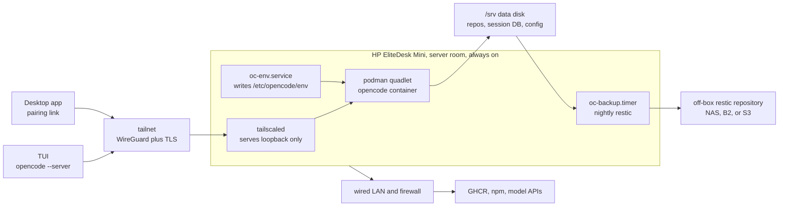

# Devbox: an always-on HP EliteDesk Mini running ucore and OpenCode

**Status:** approved for implementation
**Date:** 2026-11-05
**Supersedes:** the Azure VM design in git history before this change

## Intent

A personal AI development server that lives on an HP EliteDesk G4 35W Desktop
Mini in the head-office server room. It runs ucore-minimal as an immutable
Fedora CoreOS host, runs the OpenCode server in a rootful podman container, and
is reached only over a private tailnet. The data disk is separate from the OS
disk, and a nightly restic backup leaves the box.

The goal is unchanged: stop fighting local environment drift by making the host
and the toolchain rebuildable artifacts. The host is now physical, always on,
and costs electricity instead of Azure compute.

## Why the pivot

The Azure design worked on paper but carried a control plane that the workload
did not need: Terraform, Key Vault, ACR, a Logic App, a NAT Gateway, managed disk
snapshots, Bastion, and an idle deallocator that existed only to reduce a bill.
Every one of those is a moving part with credentials, role assignments, and
failure modes. On a small desktop in a server room, none of them earns its keep.

The pivot also removes the cost optimisation problem in `docs/headless-hosting-options.md`
(the deleted document). An always-on Mini has no scale-to-zero decision, no
ACA job-hours calculation, and no budget that makes a 4 GiB anchor necessary.

## Hardware

The host is one HP EliteDesk G4 35W Desktop Mini with these properties. Confirm
them manually before an install; nothing in the install verifies them.

| Property | Requirement | Why |
|---|---|---|
| CPU | i5-8500T or i5-8600T (6C/6T), or i7-8700T (6C/12T); i3-8100T/8300T is the floor | OpenCode, a container, and subagents run locally |
| RAM | Two DDR4 SODIMM slots, 16 GiB minimum, 32 GiB preferred | The measured idle server is small, but fan-out is not |
| OS disk | One M.2 NVMe SSD, at least 64 GiB | ucore is installed here and may be wiped on reinstall |
| Data disk | A second physical device: the second M.2 slot on the 800 G4, or a 2.5 inch SATA SSD in a caddy on either model | Sessions and repos must survive an OS reinstall |
| Network | Intel I219-LM 1GbE, wired only | A server-room box should not depend on Wi-Fi |
| Power | 35W T-series CPU, 65W external adapter, an external UPS | Power must be bridged outside the chassis during an outage |
| Firmware | UEFI, power-on after AC loss, Secure Boot off until the ucore signing key is enrolled | The box must boot and stay awake unattended |
| Out-of-band | Intel vPro/AMT if the SKU has it and the wired network allows it, otherwise physical access or a PiKVM | Tailscale is the data path, not the console |

Avoid the Pentium G5400T and G5500T: they sit below the core floor and lack
vPro. The Mini is a fixed desktop. A UPS is mandatory because a power cut has
nothing inside the chassis to bridge it. The 35W T-series part keeps the
small case cool, but a failed fan or a dust-clogged heatsink still throttles or
shuts the box down. The 65W adapter is a wear item, so keep a spare.

## Architecture

Three artifacts, three cadences:

| Layer | Built by | Updated by |
|---|---|---|
| OS | upstream `ucore-minimal:stable`, rebased once at install | `rpm-ostreed-automatic.timer`, staged, applies on next boot |
| Container | `.github/workflows/image.yml` into GHCR | `podman auto-update` on `:prod`, kept only if the health check passes |
| Data | not built | nightly restic backup to an off-box repository |

The OS and the container stay separate on purpose. Fusing them would make every
OpenCode release an OS rebuild and a reboot, which is the coupling the original
design rejected and this one keeps rejected.

## Decisions

1. **Consume upstream ucore-minimal. Do not fork it.** There is no host package
   this repo needs to add. Everything the operator uses at runtime lives in the
   container. The OS build pipeline is deleted with the Azure VHD path.

2. **Install from Fedora CoreOS installation media, then rebase to ucore.** The
   ucore project documents this as its bare-metal path. It costs two reboots on
   first install, which is a one-time cost on physical hardware. It avoids
   maintaining a custom raw image and a per-machine image build.

3. **Rootful podman quadlet, not rootless.** The container runs as a non-root
   user inside. Rootless would add `podman-restart.service` plus lingering and
   bind-mount uid mapping for no security gain on a single-operator box.

4. **Every persistent path is a bind mount under `/srv`.** Never a podman named
   volume. A named volume lives on the OS disk and would be lost when the OS is
   reinstalled.

5. **The data disk is a second physical device, prepared outside Ignition.**
   The OS can be reinstalled without touching `/srv`. The partition and
   filesystem are created once from the live media, and Ignition only mounts them
   by label. On the 800 G4 the second M.2 slot needs no caddy; on either model a
   2.5 inch SATA SSD in a caddy works. If Ignition owned the disk it
   would re-run on a reinstall and wipe the data, which is the failure this
   invariant exists to prevent.

6. **Always on. No idle deallocation and no scheduled stop.** The box is in a
   server room and the marginal cost is electricity. Suspend and hibernate are
   masked, and logind sets `IdleAction=ignore`. An external UPS bridges a short
   outage and the firmware powers the box back on after a long one. This replaces
   the Azure idle gate, the Logic App wake path, and the `oc` wrapper that called
   `az vm start`.

7. **Secrets never enter git or the image.** The OpenCode password, the Hermes
   gateway key, the model provider key and the restic credentials live in
   `/etc/devbox/secrets.env`, mode 0600, provisioned by the operator after first
   boot. No shipped file defines them. Two writers read that file and each fails
   closed: `oc-env.service` writes `/etc/opencode/env`, and `hermes-env.service`
   writes `/etc/hermes/env` after filtering to an allowlist so an unrelated
   secret cannot reach the control plane.

8. **The install media may carry a Tailscale auth key, and it is optional.**
   With `TS_AUTHKEY` set, the key is scoped to a tag, single-use or short-lived,
   and revoked after the node joins. A keyless build ships no key: the host boots
   off the tailnet and the operator joins from the console. That is the one
   exception to decision 7, and it exists because the tailnet is the path used to
   provision the other secrets. The OpenCode password never rides the install
   media.

9. **Tailscale is the only data path.** No port forward, no inbound rule, no
   public listener. `tailscale serve` publishes three loopback surfaces, each
   with a real TLS certificate: OpenCode on 443 (`127.0.0.1:4096`), the Hermes
   dashboard on 8443 (`127.0.0.1:9119`), and the Hermes gateway API on 10000
   (`127.0.0.1:8642`). Serve only accepts 443, 8443 and 10000 for HTTPS, which is
   why those three. ucore-minimal installs the Cockpit packages but not
   `cockpit-ws`, so `cockpit.socket` does not exist and nothing listens on 9090.
   An Ignition drop-in rebinds it to loopback if a future image ships it, and it
   is deliberately not published. Use Tailscale SSH plus the OpenCode and Hermes
   desktop clients. Add Cockpit later as a loopback container if it is genuinely
   needed. `docs/web-access.md` records the client path, the proof that no public
   listener exists, and the failures that look like a broken server but are not.

10. **Backups are restic to an off-box repository, not a disk snapshot.** A
    snapshot on the same box is not a backup. Restic gives encryption,
    deduplication, and version history. Retention is manual: deleting backups
    from a timer deserves a human decision.

11. **The host is not edited in place.** Host scripts, units, the quadlet, and
    the logind policy come from `os/butane/ucore.bu`. A change lands in git and
    is applied by regenerating Ignition and reinstalling, or by a deliberate
    `rpm-ostree` overlay documented in the runbook. The one runtime file is
    `/etc/devbox/secrets.env`.

12. **GitHub Actions builds the container image.** The Azure DevOps pipeline and
    the ACR path are deleted. The image goes to GHCR with the workflow token, and
    the promoted digest is recorded in `image/prod-digest.txt` by a separate
    operator PR after the build, because the workflow token cannot push to
    `main`. The toolbox base is pinned by digest to the released Fedora stream,
    not to the version-labelled tag: the `46` tag is labelled `rawhide` today, so
    a bump is a deliberate PR that reads the tag's digest from the registry.

13. **Every build autologins `core` on the local console.** A keyless build has
    no tailnet and `sshd` is masked, so the console is the only door before the
    join. A keyed build also loses its door when the key expires or the node is
    revoked, so the console is the recovery path either way. Fedora CoreOS
    ignores `coreos.autologin`, so Ignition writes a `getty@tty1` drop-in.
    `core` has passwordless sudo, which means anyone with the keyboard has the
    box. Physical access to the unencrypted disk already implies that. Intel AMT
    is optional and stays a second recovery path.

14. **The Hermes control plane runs the official upstream image, and only that
    container is exempt from the Fedora-family rule.** Hermes schedules and
    delegates work to the OpenCode server. Nous Research publishes the image as
    `nousresearch/hermes-agent`, and no Fedora-based build is offered, so it is
    consumed as published rather than rebuilt. The waiver is scoped: the
    container still publishes on loopback only, still loads its secrets from a
    fail-closed environment file, and still persists under `/srv`. It reaches
    OpenCode at `http://opencode:4096` on the shared `devbox` podman network, so
    neither port leaves the host. Every other layer in the repo stays Fedora.

## Secrets

| Secret | Where it lives | Written by |
|---|---|---|
| `OPENCODE_PASSWORD` | `/etc/devbox/secrets.env`, mode 0600 | Operator, after first boot |
| `API_SERVER_KEY` | `/etc/devbox/secrets.env` | Operator, after first boot |
| One of `OPENROUTER_API_KEY`, `ANTHROPIC_API_KEY`, `OPENAI_API_KEY`, `GOOGLE_API_KEY` | `/etc/devbox/secrets.env` | Operator, after first boot |
| `HERMES_DASHBOARD_BASIC_AUTH_*`, `TELEGRAM_BOT_TOKEN`, `DISCORD_BOT_TOKEN`, `TZ` | `/etc/devbox/secrets.env` | Operator, optional |
| `RESTIC_REPOSITORY`, `RESTIC_PASSWORD` | `/etc/devbox/secrets.env` | Operator, after first boot |
| Tailscale auth key | `/etc/devbox/tailscale-authkey`, mode 0600, in Ignition | `os/butane/build.sh` from `TS_AUTHKEY`; empty in a keyless build |
| SSH public key | Ignition, no secret | `os/butane/build.sh` from `SSH_PUBKEY` |

`oc-env.service` reads `OPENCODE_PASSWORD` from `secrets.env` and writes
`/etc/opencode/env` for the OpenCode quadlet. It fails closed when the password is
absent or empty. The quadlet carries `Requires=oc-env.service`, so a failed
bootstrap does not serve a passwordless server.

`hermes-env.service` reads the same file and writes `/etc/hermes/env` for the
Hermes quadlet. It requires `OPENCODE_PASSWORD` (the credential Hermes delegates
with), `API_SERVER_KEY` (the gateway's own auth) and at least one model provider
key. Optional keys are copied when set, and an allowlist keeps unrelated secrets
out of the control plane's environment. It also fails closed and is `Requires=`
by its quadlet.

In a keyed build, the Tailscale key is the only secret on the install media.
Revoke it in the Tailscale admin console after the node appears. The node
identity and state live in `/var/lib/tailscale`, so revoking the key does not
disconnect the box. A keyless build ships no key at all.

## Backup and recovery

`oc-backup.timer` runs nightly and invokes restic in the project's Fedora image
against `RESTIC_REPOSITORY`. Using the project image keeps the Fedora-family rule:
the upstream restic image is Alpine. `oc-restic` passes only the `RESTIC_*`,
`AWS_*` and `B2_*` variables, so the workload password never reaches the backup
container. The repository is off the Mini. Backblaze B2 or any S3-compatible
endpoint is acceptable, including a NAS that exposes S3; the repository URL and
credentials are the operator's choice and live in `secrets.env`. An SFTP
repository needs an SSH key mounted into the container, which the script does not
do.

The backup stops both workloads before the snapshot and starts them again after,
so neither SQLite store is captured mid-write. The cost is a brief nightly outage
of both servers, which the always-on host survives.

The restore path is `restic restore` onto a scratch device, verify, then copy the
`/data` tree into `/srv`. The runbook contains the drill. A backup that has never
been restored is an assumption, not a backup.

Retention is manual. The timer backs up and never calls `restic forget` or
`restic prune`. Pruning is a human step because deleting the wrong snapshot is
irreversible.

## Network

The box has one wired NIC and joins the LAN. The router should give it a stable
DHCP reservation so the address does not move, but Tailscale does not depend on
the LAN address. Outbound HTTPS to GHCR, Fedora mirrors, npm, and the model APIs
is required. If the LAN blocks outbound UDP, Tailscale falls back to DERP over
TCP 443; test the path before relying on it.

There is no inbound port forward. The host firewall rejects inbound traffic
except established flows. The only listeners are loopback: OpenCode on 4096, the
Hermes gateway on 8642 and its dashboard on 9119, and `tailscaled` for the
tailnet. `cockpit.socket` does not exist on ucore-minimal; if an image ships it,
an Ignition drop-in binds it to 9090 on loopback. `tailscale serve` terminates
TLS and proxies to loopback. `sshd` is masked because Fedora CoreOS enables it
and the server firewall profile would expose it on the LAN. Shell access is
Tailscale SSH, which runs inside `tailscaled`.

systemd-resolved answers LLMNR on 5355 and mDNS on 5353 on every interface by
default. Neither is a systemd socket, so masking or rebinding a unit cannot close
them. Ignition switches both off in a `resolved.conf.d` drop-in, and
`host/tests/test_no_lan_listener.sh` fails on a config that drops it.

## Risks the cloud hid

| Risk | Consequence | Mitigation |
|---|---|---|
| Power loss or UPS failure | Unclean shutdown, filesystem damage | UPS bridges a short outage; test it quarterly; set AC power-on after loss in firmware; restic backup |
| External PSU failure | The box stops with no warning | Keep a spare 65W adapter and watch the journal for brownout resets |
| Thermal throttling, fan failure, or dust | Slow box, then shutdown | 35W T-series keeps heat low; monitor `sensors`, clean dust, set a thermal shutdown policy |
| No room for the second disk | The data disk cannot be fitted, so the design fails its separate-device invariant | Confirm the second M.2 slot or the 2.5 inch caddy before buying; treat the second device as mandatory |
| Single data disk failure | Loss of uncommitted work | Off-box restic backup, push code, monitor SMART |
| No out-of-band management | A hung box needs a physical visit | Enable AMT/vPro if present, otherwise a PiKVM or documented console access |
| NIC or firmware bug | Tailnet or network drops after update | Prefer wired Ethernet, pin firmware updates, keep a USB Ethernet adapter as a spare |
| Theft or physical access | Disk readable | Server-room access control; LUKS is a documented optional hardening step, not the default because unattended reboot needs a TPM or key file |

## Anti-goals

- A hand-edited running host. If a fix was applied by SSH and not committed, the
  design failed.
- An in-flight agent turn killed by a deploy or a suspend.
- A secret written into git, an image layer, or the install media beyond the
  scoped Tailscale key.
- A rebuild that cannot reproduce the previous host.
- Two tools managing the same host configuration.

## What is not verified

No install has run on the target Mini. The container image has not been built
by the GitHub Actions workflow. The restic restore drill has not been executed.
The ucore autorebase path is documented upstream but has not been exercised on
this hardware. Treat every one of those as unproven until it runs.
