# Dogfood the devbox in a QEMU VM

This is the path that exercises the shipped Ignition without the Mini. It boots
the pinned Fedora CoreOS QEMU image, applies the Ignition compiled from
`os/butane/ucore.bu`, lets the one-shot rebase replace Fedora CoreOS with
ucore-minimal, then runs a check suite inside the guest and posts the result to
the host.

It is not a substitute for the first install on the Mini. It is the rehearsal for
it: it proves the config and the container start path on emulated hardware before
any disk on the Mini is touched. It cannot prove the disk ids, the firmware, the
UPS, the tailnet join, or the thermal behaviour.

```mermaid
flowchart LR
  P["vm/fcos.json<br/>pinned release + sha256"] --> F["fetch-fcos.sh<br/>verify + decompress"]
  F --> B["build-ignition.sh<br/>os/butane/build.sh"]
  B --> O["overlay-ignition.sh<br/>serial + harness units"]
  O --> Q["qemu-system-x86_64<br/>qcow2 OS + raw data disk"]
  Q --> R["first boot: FCOS<br/>ucore-autorebase.service"]
  R --> U["second boot: ucore<br/>devbox-vm-check.service"]
  U --> A["report-agent.py<br/>127.0.0.1, guest at 10.0.2.2"]
  A --> REP["pass or fail<br/>exit code + .vm-cache/report.txt"]
```



## When to run it

Run it before the first install on the Mini, and before any change under
`os/butane/`, `host/`, `image/` or a quadlet reaches the Mini. It is step 0 of
`docs/install.md` and the rehearsal procedure in `docs/runbook.md`.

Skip it for a docs-only, test-only or CI-only change, because none of those reach
the Ignition or the container image.

Rerun it when the pinned Fedora CoreOS release moves (`vm/fcos.json`) and after an
upstream `ucore-minimal` change you have not booted yet. The rebase and the
container pull are the two paths that consume third-party state, and both can
break without a commit here.

## Requirements

- `qemu-system-x86_64` and `qemu-img` (QEMU 8 or newer; tested on 11).
- `jq`, `curl`, `python3`, `ssh-keygen`, `xz`, `sha256sum`.
- Butane 0.29.0, as `BUTANE` or `butane` on `PATH`, to compile the Ignition.
- `socat` is optional. Without it the harness still runs, and only the serial
  console attach and the graceful shutdown are unavailable.
- No root. The base image is downloaded and verified as the calling user, and
  the data disk is a plain file under `.vm-cache/`.
- KVM is optional. Without a readable `/dev/kvm` the harness falls back to TCG
  and says so; the rebase then takes noticeably longer.
- About 10 GiB of free disk space for the base image, the OS overlay, the data
  disk, and the container layers.

## Run it

```sh
./vm/run-vm.sh
```

The first run downloads and verifies the pinned Fedora CoreOS image (about
900 MiB), builds the Ignition, creates the two disks, and boots. The whole path
takes roughly 10 to 20 minutes, mostly the ucore rebase download. It ends with
`VM DOGFOOD: pass` or a list of `FAIL` lines, and the exit code is non-zero when
anything failed.

On success the VM keeps running so you can look inside. Attach to the serial
console (the guest autologins as `core`):

```sh
socat -,raw,echo=0 UNIX-CONNECT:.vm-cache/serial.sock
```

Detach with `Ctrl-a x`. Stop the VM with:

```sh
./vm/run-vm.sh --stop
```

Useful flags:

| Flag | Effect |
|---|---|
| `--console` | boot, then attach the serial console in the foreground |
| `--rebuild` | discard the OS overlay and the data disk, then repeat first boot |
| `--stop` | power down the running VM |
| `--stop-after-check` | power down as soon as the report arrives |
| `--timeout SECONDS` | how long to wait for the report (default 2400) |
| `--dry-run` | print the disk plan (each step it would write or reuse) and the exact qemu command, then exit; touches nothing |
| `--disks-only` | create or reuse the two disks, then exit before QEMU; the gate's disk write test uses it |

Environment overrides: `VM_CACHE`, `VM_MEM` (default 4096), `VM_CPUS` (4),
`VM_DISK_SIZE` (32G), `VM_DATA_SIZE` (8G), `VM_AGENT_PORT` (8123), `VM_TIMEOUT`
(2400), `VM_HOSTNAME` (`devbox-vm`), `VM_AGENT_URL` (baked into the Ignition),
`VM_IMAGE` (default `ghcr.io/ultus-net/devbox:prod`), `VM_BASE_IMAGE` (a base
image path, used to skip the download), `KVM_DEVICE`, `QEMU`.

## Ignition runs once

Ignition is first-boot only. Editing `os/butane/ucore.bu` and rerunning is not
enough: the existing OS overlay has already consumed the old config and keeps
its `/etc`. Use `--rebuild` to throw away the overlay and the data disk, which
is also the way to reproduce the install from a clean slate. Without
`--rebuild`, a second `run-vm.sh` boots the existing install and waits for a
report that the check unit will not produce again.

The committed `os/butane/ucore.ign` is never written. The harness compiles to
`.vm-cache/devbox-vm-base.ign` and merges its overlay into
`.vm-cache/devbox-vm.ign`.

## What the VM adds on top of the shipped config

The overlay only appends, and the merge is idempotent:

- a `serial-getty@ttyS0` autologin drop-in, so the console has a shell;
- `devbox-vm-check.service`, which runs `guest-check.sh` on the first ucore
  boot and posts its report;
- `devbox-vm-data.service`, which prepares the blank data disk before
  `var-srv.mount`.

The last one is the one deliberate difference from production. The real install
prepares the data disk once from the live media (step 4.4 of
`docs/install.md`). A VM has no live-media phase, so the harness gives the guest
a blank disk and runs `systemd-repart` on it before `var-srv.mount`. That produces
the same GPT partition and ext4 label the mount unit looks up. Ignition still
only mounts by label and never partitions or formats. Nothing in `ucore.bu`
changes.

That unit's script lives in `/etc/devbox-vm/`, not `/usr/local/sbin/` like the
shipped scripts. It runs before `local-fs.target`, where `/var` is not mounted
yet and `/usr/local` (a symlink into `/var`) does not resolve, so a script there
fails with `203/EXEC`. `/etc` is on the root filesystem and is always present.
Its output goes to the serial console as well as the journal, because a oneshot
that fails there is otherwise invisible.

## What it checks

The guest check asserts, in order:

| Area | Assertion |
|---|---|
| rebase | the booted deployment names `ucore-minimal`, and the hostname is `devbox-vm` |
| tailnet | `tailscaled` is enabled; a keyless build is not joined |
| data disk | `/srv` is mounted, its source is a different device from `/var`, carries the `data` label, and `/srv/repos` is uid 1000 |
| always on | all five sleep targets are masked and logind's `IdleAction` is `ignore` |
| one door | `sshd` is masked, and Cockpit listens on `127.0.0.1:9090` when the image ships `cockpit.socket` |
| fail closed | with no `secrets.env`, `/etc/opencode/env` does not exist, `oc-env.service` has failed, and OpenCode is inactive |
| boot | systemd reports a boot target wanting both quadlet units, so a reboot brings them up |
| secrets | after a dummy `secrets.env`, both env writers are active and their files are 0600 |
| image | the published `ghcr.io/ultus-net/devbox:prod` pulls |
| workloads | `opencode` and `hermes` are healthy, 4096, 8642, and 9119 are bound on loopback, and a connection to each loopback port succeeds |
| invariant | no TCP listener is on `0.0.0.0` or `[::]`; the scan names the owning process |

The dummy secrets are `vm-dogfood-not-a-secret` values written inside the
throwaway VM. The strings themselves are committed in `vm/guest-check.sh`, and no
real credential ever reaches the host or the repository.

Podman generates `opencode.service` and `hermes.service` from the quadlet files,
and those units cannot be `systemctl enable`d. The generator applies each
quadlet's `[Install]` section when it writes the unit, so the check reads
systemd's `WantedBy` property rather than a symlink under `/etc`. Without a boot
target the box comes up serving nothing, so the check fails rather than noting it.

`vm/tests/` holds the host-side guards: the overlay merge keeps every base file,
link, directory and unit and is idempotent, the boot command carries both disks
and no inbound forward, the guest check defines every helper it calls, the
booted-deployment parse and the parent-device comparison are driven from
fixtures, the report agent refuses a truncated post, the report verdict demands
the summary line, and the data-disk script refuses the device that backs `/`
including its `[/ostree/...]` spelling.

## The run that proved it

On 2026-11-11 the harness ran `./vm/run-vm.sh --rebuild` at the tip of this
branch and reported `VM DOGFOOD: pass` with zero failures. That run covered first
boot on Fedora CoreOS, the rebase to `ucore-minimal:stable`, the second boot,
`systemd-repart` on the blank data disk, `var-srv.mount` on a device separate
from `/var`, a dummy `secrets.env`, both containers healthy, and all three
loopback ports. It reported one `SKIP`: `cockpit-loopback`, because the image
ships no `cockpit.socket`.

`SUMMARY failures=0` is the line to look for. A `SKIP` is a conditional guard
whose condition the image does not meet, and the report says which one.

## What it found

These were found by running the harness, not by reading the config:

| Finding | Evidence | Fix |
|---|---|---|
| the repart definition cannot live under `/usr/lib` | Ignition fails first boot: `mkdir /sysroot/usr/lib/devbox-vm: read-only file system` | the overlay writes it to `/etc/devbox-vm/repart/` |
| a pre-`local-fs` unit cannot exec `/usr/local/sbin/...` | `devbox-vm-data.service` fails `203/EXEC`; `/var` is a separate mount and `/usr/local` is a symlink into it | the data script lives in `/etc/devbox-vm/` |
| `loginctl show -p IdleAction` is the wrong property | the per-session value is empty even when the manager ignores idle | the check reads the logind Manager property over the bus |
| `srv.mount` can never mount on Fedora CoreOS | `srv.mount: Mount path /srv is not canonical (contains a symlink)`; `/srv` is a symlink to `var/srv` | the unit is `var-srv.mount` with `Where=/var/srv`, and the check proves `/srv` is not on the OS disk |
| systemd-resolved answered on the LAN | the wildcard scan reported `0.0.0.0:5355` and `[::]:5355`; LLMNR and mDNS are responders and are not systemd sockets | Ignition sets `LLMNR=no` and `MulticastDNS=no` in a `resolved.conf.d` drop-in |
| the quadlet boot check looked in the wrong place | it scanned `/etc/systemd/system/*.wants`, but quadlets cannot be enabled and the generator applies `[Install]` in `/run` | the check reads systemd's `WantedBy` property, which is the same data systemd starts from |
| ucore-minimal ships no Cockpit socket | `cockpit.socket` is `not-found`; the image installs `cockpit-bridge` and `cockpit-system` but not `cockpit-ws` | the documentation now calls the loopback rebind conditional, and the drop-in stays as a guard |
| the mount check asked for the wrong state | `systemctl is-active` prints `active` for a mount; `mounted` is the SUB state and never appears | the check asserts `active`, and the comment records why |
| the version check rejected the real output | `opencode --version` prints `opencode v2.1.4`, and an anchored regex failed it | the regex accepts a semver token anywhere in the line |
| `podman port` takes one container | passing two names made the second a port and printed nothing | the check calls it once per container |
| the Hermes dashboard answers 404 to a bare GET | a reachability probe read 404 as down | the check opens a TCP connection, with a retry until the port binds |

## How the host sees the result

The guest reaches the host through qemu's user network at `10.0.2.2`. The
harness binds `report-agent.py` to `127.0.0.1` only: there is no host port
forward and no listener on the LAN. The guest posts its report, and the run
script exits non-zero on any `FAIL` line or on a report that lacks the
`SUMMARY failures=0` line the guest writes last, so a truncated post cannot read
as a pass. The report is also left at `.vm-cache/report.txt` and
`/srv/devbox-vm-report.txt` inside the VM.

If the check unit never runs, the harness times out and prints the last 40
lines of `.vm-cache/serial.log`. The usual causes are a failed rebase
(`journalctl -u ucore-autorebase.service` on the console) or a `var-srv.mount`
failure (`systemctl status var-srv.mount`).

## What it must not claim

A passing VM run does not verify the target Mini, its firmware, Secure Boot
enrolment, the two physical disk ids, the tailnet join and ACL, `tailscale
serve` TLS, the UPS, thermals, or the restic restore drill. Those stay on the
list in `README.md` until they run on real hardware.
