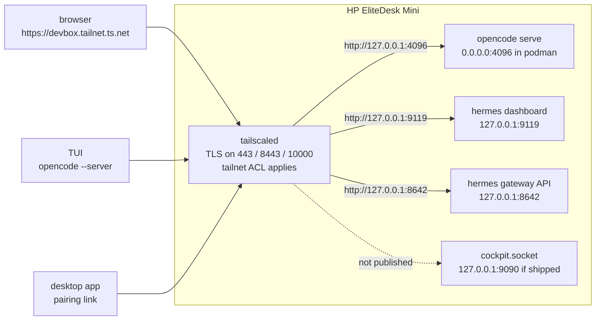

# Reach the OpenCode web UI over the tailnet

`docs/install.md` builds the machine. This file covers the client path: what the
box publishes, how to open it from a browser, how to prove the path works, how to
schedule long work, and how to take the publication down again.

The box has one door: the tailnet. `tailscale serve` terminates TLS for
`https://<host>.<tailnet>.ts.net` and proxies three loopback surfaces: the
OpenCode server, the Hermes dashboard, and the Hermes gateway API. There is no
public listener, no inbound port forward, and no Funnel.

## The invariant: never reachable from the internet

Avoiding public exposure is the reason this path exists. Every other property
gives way to it, and the commands in this file are chosen to preserve it.

- `tailscale serve` publishes to the tailnet only. It is a different command from
  `tailscale funnel`, which publishes to the public internet.
- Funnel is never configured. `tailscale funnel status` must show no
  `Available on the internet` block.
- There is no public IP, no inbound port forward, and no inbound firewall rule.
- The tailnet ACL still applies to a serve mount. A device outside the policy
  cannot reach the UI even if it is on the tailnet.
- Remote access stays off. Three routes expose the server through OpenTunnel:
  `opencode pair --remote`, `opencode service set remote true`, and the desktop
  app's remote pairing flow. Never use them on this box. Leave the setting off
  with `opencode service set remote false`.

A change that breaks one of those lines is a security regression, not an access
tweak. It needs a design change, not a runbook step.

## What is published



| Hop | Address | Who terminates TLS |
|---|---|---|
| OpenCode, client to box | `https://<host>.<tailnet>.ts.net:443` | `tailscaled`, with a certificate for the tailnet name |
| OpenCode, box to container | `http://127.0.0.1:4096` | nobody, loopback only |
| Hermes dashboard | `https://<host>.<tailnet>.ts.net:8443` → `http://127.0.0.1:9119` | `tailscaled` |
| Hermes gateway API | `https://<host>.<tailnet>.ts.net:10000` → `http://127.0.0.1:8642` | `tailscaled` |
| Cockpit, if the image ships its socket | `http://127.0.0.1:9090` | not published, by design |

The pieces that produce this:

- `host/quadlet/opencode.container` publishes `127.0.0.1:4096:4096` and
  `host/quadlet/hermes.container` publishes `127.0.0.1:8642:8642` and
  `127.0.0.1:9119:9119`, so every host port is loopback only. Each container
  binds its own port inside its network namespace.
- `host/quadlet/devbox.network` gives the two containers name resolution, so
  Hermes reaches the server at `http://opencode:4096` without either port
  leaving loopback.
- `os/butane/ucore.bu` enables `oc-tailnet.service`, a one-shot unit that runs
  `oc-tailnet` after `tailscaled` is up.
- `host/bin/oc-tailnet` runs one `tailscale serve --bg --https=<port>
  http://127.0.0.1:<port>` per surface (443, 8443, 10000, the only ports Serve
  accepts for HTTPS) and `tailscale set --ssh=true`. `--bg` makes each mount
  survive a reboot and a `tailscale down`/`up`.
- Tailscale provisions the certificate. There is no `tailscale cert` step and no
  certificate file on the host.

Funnel is never enabled. A serve mount and a funnel mount cannot share a port, so
`tailscale funnel status` must show no `Available on the internet` block. An
empty state may print `No serve config`.

## The ladder, and why this box sits on rung 2

There is a well-known progression for reaching a loopback service from another
machine. Each rung removes a manual step and adds a piece that has to be
maintained.

| Rung | Mechanism | Cost | Verdict here |
|---|---|---|---|
| 0 | `ssh -L 4096:127.0.0.1:4096` from the client | A tunnel per client, per session. Dies with the shell. | Rejected: manual, and the user asked for no port forwarding |
| 1 | Publish the container port on `0.0.0.0` or the LAN address | A second door on the wired LAN. No TLS. | Rejected: violates the one-door rule, and `test_no_lan_listener.sh` fails |
| 2 | `tailscale serve` on the host, backend on loopback | One host unit and one line of config | **Chosen.** Tailnet-only by construction, real TLS, ACL applies, survives reboot, no client setup |
| 3 | A proxy sidecar per service, joined separately | One more container, image and update cadence per service | Rejected for one service: more moving parts than the service |
| 4 | `tsnet` in the application | The app embeds Tailscale and joins on its own | Rejected: OpenCode does not embed `tsnet`, so this means a fork |

The box stays on rung 2 because it publishes exactly one HTTP service. A sidecar
or `tsnet` earns its keep when there are many services with independent
lifecycles. This repo has one.

## Open the UI in a browser

The canonical address is the MagicDNS FQDN:

```text
https://devbox.<tailnet>.ts.net
```

`<tailnet>.ts.net` is the tailnet DNS name from the Tailscale admin console. The
hostname is `OC_HOSTNAME` from the install build, `devbox` by default.

Only some spellings of the address reach the box. The rest hit a loopback port on
the wrong machine.

| Spelling | Works | Why |
|---|---|---|
| `https://devbox.<tailnet>.ts.net` | yes | The certificate name and the serve mount |
| `https://devbox` | on a tailnet device with MagicDNS | Short name resolves, but may warn on the certificate |
| `https://<tailnet-ip>` | no | Serve answers on the TLS name, not the raw IP |
| `http://devbox:4096` | no | 4096 is loopback on the box, not on the tailnet |
| `http://127.0.0.1:4096` | only on the box | Raw loopback listener |

Use the FQDN. It is the name the certificate covers and the name a saved client
URL keeps working across restarts.

### Sign in

OpenCode protects the API with HTTP Basic auth. The username is `opencode`; the
password is `OPENCODE_PASSWORD` from the password manager entry used in
`docs/install.md` step 7. The browser shows the native Basic realm prompt on the
first API call.

Two responses look contradictory until you know which is which. Measured against
OpenCode 2.1.4, the version pinned in `image/Dockerfile`:

| Request | Without credentials | With credentials |
|---|---|---|
| `GET /` | `200`, the HTML application shell | `200` |
| `GET /api/info` | `401` with `WWW-Authenticate: Basic realm="Secure Area"` | `200` JSON |

A `200` on `/` proves the proxy reached the container. It does not prove the
password works. Use `/api/info` for that check.

Tailscale forwards the inbound `Host` header and adds `Tailscale-User-*`
identity headers. OpenCode does not pin the host name, so the tailnet name is
accepted. This was measured locally with a `Host: devbox.example.ts.net` header
against OpenCode 2.1.4.

### CORS is not needed for this UI

The UI and the API are served from the same origin, so the browser makes
same-origin requests and no CORS rule applies. Measured: a request carrying
`Origin: http://localhost:4096` gets `Access-Control-Allow-Origin` back, and an
unlisted origin gets no CORS header at all. The tailnet origin is not in the
default list, which is fine while the page is served from that origin.

Add `--cors` only when a browser page from another origin calls the API, for
example a web client you run on your laptop. The flag is repeatable:

```sh
opencode serve --hostname 0.0.0.0 --port 4096 \
  --cors https://laptop.example.ts.net
```

The container does not set that flag today. To add it, override the command in
`host/quadlet/opencode.container`:

```ini
[Container]
Exec=serve --hostname 0.0.0.0 --port 4096 --cors https://laptop.example.ts.net
```

That is a host change, so it lands in git and reaches the box through Ignition
(design decision 11). Do not hand-edit the quadlet on the running host.

## Other clients

The same origin serves three clients. All of them read
`OPENCODE_PASSWORD` from the password manager.

```sh
# Read the password without echoing it or writing it to shell history.
read -rsp 'OpenCode password: ' OPENCODE_PASSWORD; export OPENCODE_PASSWORD

# TUI against the remote server
opencode --server https://devbox.<tailnet>.ts.net

# Desktop app: prints a single-use pairing link that expires in five minutes
opencode pair --url https://devbox.<tailnet>.ts.net

# One turn, non-interactive, from a CI job or a schedule
opencode run --server https://devbox.<tailnet>.ts.net "summarise the failing tests"
```

Never run `opencode pair --remote`, `opencode service set remote true`, or the
desktop app's remote pairing flow. All three expose the server to the public
internet through OpenTunnel. A client that needs access away from home joins the
tailnet. The server does not move to the internet.

### Long-horizon work

Three properties matter when a turn runs for hours:

- Sessions and the session database live on `/srv`, so a client can disconnect
  and reattach with `opencode session list` and `--session`. An OS reinstall does
  not take them.
- The box never sleeps. Sleep targets are masked and logind sets
  `IdleAction=ignore`, so an idle policy cannot cut a turn.
- `oc-backup.timer` stops the container at 02:00, adds up to 30 minutes of
  randomised delay, then starts it after the snapshot. A turn that spans that
  window is interrupted. Finish long work before 02:00, start it after 02:30, or
  move the timer deliberately in `os/butane/ucore.bu` and regenerate Ignition.

## Verify the path

Run `docs/install.md` step 6 first. The tailnet has to answer before anything
below means much.

### On the box

```sh
ssh core@devbox 'tailscale serve status'
ssh core@devbox 'tailscale funnel status'
ssh core@devbox 'ss -ltn | grep -E "127\.0\.0\.1:4096"'
ssh core@devbox 'sudo podman ps --format "{{.Names}} {{.Status}}"'
ssh core@devbox 'sudo systemctl is-active oc-env opencode oc-tailnet'
```

| Command | Passes when |
|---|---|
| `serve status` | Names `https://devbox.<tailnet>.ts.net` and proxies `/` to `http://127.0.0.1:4096` |
| `funnel status` | Shows no `Available on the internet` block |
| `ss -ltn` | Shows `127.0.0.1:4096`, and no `0.0.0.0` or `*:4096`. Add `127.0.0.1:9090` only when the image ships `cockpit.socket` |
| `podman ps` | The container reads `healthy` |
| `is-active` | Prints `active` three times |

Then prove the password reaches the server. Run this on the box. `curl` prompts
for the password, so it never enters shell history or the process list:

```sh
curl -s -o /dev/null -w '%{http_code}\n' http://127.0.0.1:4096/api/info
curl -s -u opencode http://127.0.0.1:4096/api/info
```

The first code is `401`. The second is `200` with a JSON body naming the version.

### From another tailnet machine

```sh
tailscale ping devbox
curl -s -o /dev/null -w '%{http_code}\n' https://devbox.<tailnet>.ts.net/api/info
curl -s -u opencode https://devbox.<tailnet>.ts.net/api/info
```

The first code is `401`, the second is `200`, and the certificate is valid with
no `-k`. The second `curl` prompts for the password; do not put it in the URL or
on the command line. Before trusting a result, prove the negative too:

```sh
curl -sS --max-time 5 http://<tailnet-ip>:4096/     # must refuse or time out
curl -sS --max-time 5 http://devbox:4096/           # must refuse or time out
```

A success on either line means a second door exists. Fix it before opening the
browser.

Run the same request from a device that is not on the tailnet. It must fail to
connect or fail to resolve. A success means the box is publicly reachable, which
is the exact failure this design prevents.

### In the browser

1. Open `https://devbox.<tailnet>.ts.net`.
2. Accept the certificate without an exception.
3. Enter `opencode` and the password.
4. Confirm the session list loads and a new session starts.

If the page loads but the session list stays empty with a `401` in the developer
console, the password is wrong for this build. Rotate it with `docs/runbook.md`
and restart `oc-env` and `opencode`.

## Take the publication down

`tailscale serve reset` clears every serve mount on the box, including this one.
`--bg` made the mount persistent, so reset is the only thing that removes it.
Restarting `oc-tailnet.service` puts the OpenCode mount back. The unit is
`RemainAfterExit=yes`, so it does not re-run on its own after a reset.

```sh
ssh core@devbox 'sudo tailscale serve reset'
ssh core@devbox 'tailscale serve status'
```

To remove one mount only:

```sh
ssh core@devbox 'sudo tailscale serve --https=443 off'
```

Stopping the unit does not remove a `--bg` mount. Reset the mount first, then
stop the unit.

To take the box off the tailnet entirely, reset the mount and disable the unit.
Disabling persists across reboots. Re-enable it with
`sudo systemctl enable --now oc-tailnet.service`.

```sh
ssh core@devbox 'sudo tailscale serve reset'
ssh core@devbox 'sudo systemctl disable --now oc-tailnet.service'
```

Removing Tailscale SSH ends the session that runs the command. Run that step last,
from the tty1 console, not over the shell it is about to remove:

```sh
# From the tty1 console, after the steps above.
sudo tailscale set --ssh=false
sudo tailscale down
```

The console autologin is the recovery path while the tailnet is down. A permanent
removal is a change to `os/butane/ucore.bu` and an Ignition rebuild, not a
hand-edit on the host.

If `tailscale funnel status` ever shows a mount, remove it with
`sudo tailscale funnel reset`. Funnel is a separate publication and this repo
never configures it.

## Known failures

| Symptom | Cause | Fix |
|---|---|---|
| `tailscale serve` prints `Serve is not enabled on your tailnet` or a login URL | HTTPS certificates are off for the tailnet | Enable HTTPS in the admin console DNS page, then restart `oc-tailnet` |
| `oc-tailnet.service` failed, `serve status` empty | Keyless build that was never joined | Join from the console, per `docs/install.md` step 6 |
| Browser: name does not resolve | Client is not on the tailnet, or MagicDNS is off | `tailscale status` on the client, then enable MagicDNS |
| Browser: connection refused on 443 | Serve mount missing, or `tailscaled` down | `serve status`, `systemctl status tailscaled` |
| Serve returns `502` | Container is down, or nothing listens on `127.0.0.1:4096` | `podman ps`, `systemctl status oc-env opencode`, `ss -ltn` |
| Browser loops on the password prompt | Username is not `opencode`, or the cached credential is stale | Clear the saved credential for the origin and retry |
| Password from the manager is rejected, journal shows `server password ...` | `OPENCODE_PASSWORD` never reached the process, so the server generated one | Check `/etc/opencode/env`, fix `secrets.env`, restart `oc-env` and `opencode` |
| `/` returns `200` but `/api/info` returns `401` | Expected: the shell is unauthenticated, the API is not | Authenticate; this is not a fault |
| `/api/info` returns `200` | Authentication is off | Treat it as a fault; this build always sets a password |
| Rotated the password but the old one still works | `oc-env` and the container were not restarted | `systemctl restart oc-env.service opencode.service` |
| `oc-env` fails and the container will not start | `OPENCODE_PASSWORD` is absent or empty in `secrets.env` | Fix the file, keep mode `0600`, restart `oc-env` |
| Browser: CORS error naming another origin | A page from a different origin calls the API | Serve the UI from the tailnet origin, or add `--cors` through a git change |
| ACL denies the node | The node is untagged or the tailnet policy has no rule for `tag:devbox` | Re-join with a tagged key; check the policy in the admin console |
| `tailscale serve` exits 0 but nothing is mounted | The CLI can warn and still exit 0 | Trust `tailscale serve status`, never the exit code |
| Funnel and serve fight over 443 | The same port cannot be both | `tailscale funnel reset` |

## Cockpit stays loopback-only

ucore-minimal installs the Cockpit packages but not `cockpit-ws`, so there is no
`cockpit.socket` and nothing listens on 9090. If an image ships the socket, the
Ignition drop-in binds it to loopback. Either way Cockpit is not published, and
this file does not publish it. The service runs privileged with `/` mounted, so a
serve mount would hand root-equivalent control to anyone the tailnet ACL admits.
`docs/design.md` decision 9 keeps it off the tailnet, and
`host/tests/test_cockpit_loopback.sh` fails if `oc-tailnet` serves a target other
than the three loopback ports it publishes: OpenCode, the Hermes dashboard and
the Hermes gateway.

A shell is Tailscale SSH. If you need the Cockpit UI, publishing it is a design
change with its own guard, not a runbook command.

## What has not run

The OpenCode responses in this file were measured against OpenCode 2.1.4, the
version pinned in `image/Dockerfile`, on a workstation. No `tailscale serve` mount
has been exercised on the target Mini, and no browser has loaded the UI through
the tailnet. Treat the commands as the procedure and the checklist as the proof,
not as a report of a completed run.
